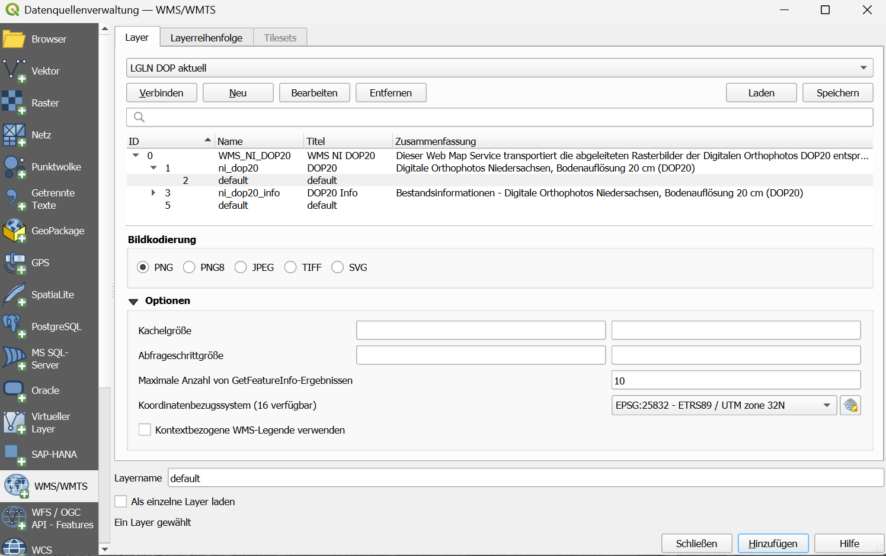
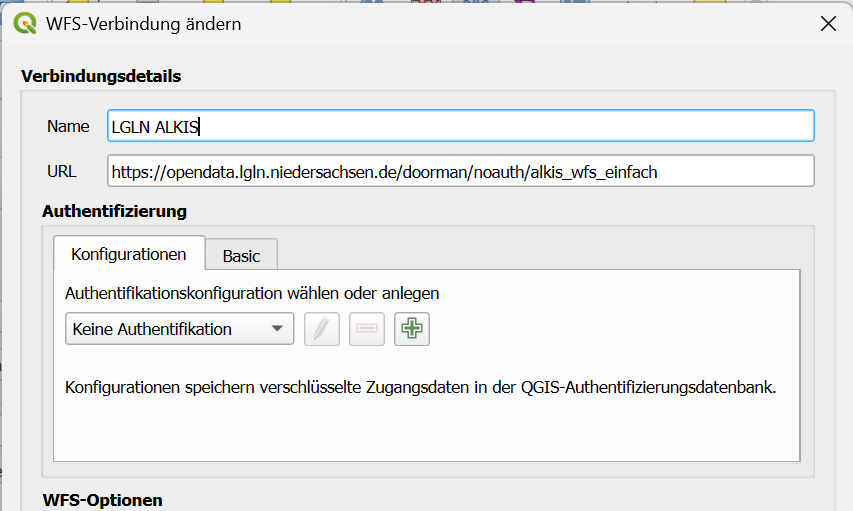

```{=html}
<!--

Skripte für die Übungen 03 des Moduls FPM08 Forstliche Fernerkundung im Studiengang
B.Sc. Forstwirtschaft an der HAWK Göttingen.

Autor: Paul Magdon
Datum: 2025-10-18
Letztes Update: 2026-10-13 (Hans Fuchs)
Lizenz: Creative Commons BY-NC-SA 4.0 https://creativecommons.org/licenses/by-nc-sa/4.0/

-->
```

# Lerneinheit 03: Beschaffung von Geodaten für den Nordcampus Göttingen

## Lernziele und Aufgabenstellung

In der Lerneinheit 02 haben wir vorgestellt, wie Rasterdaten, welche als GeoTIF-Datei auf der
Festplatte vorliegen, in ein QGIS-Projekt importiert und dargestellt werden können. Dazu wurden
Rasterdaten über das lokale Netzlaufwerk zur Verfügung gestellt. In der Lerneinheit 03 wird nun
gezeigt, wie frei verfügbare Raster- und Vektordaten gesucht, beschafft und in QGIS-Projekte
eingebunden werden können. Dazu werden Daten-Download-Portale der Landesvermessungsämter am Beispiel
von Niedersachsen vorgestellt. Wenn größere Gebiete bearbeitet und / oder sehr hohe räumliche
Auflösungen verwendet werden, kann dies sehr schnell zu einem hohen Zeitaufwand und Bedarf an
lokalem Speicherplatz - und damit verbunden hohen Kosten für die Hardware - führen. Daher werden im
GIS-Bereich zunehmend sogenannte Geodatendienste verwendet. Bei diesen Diensten werden die Daten auf
zentralen Servern gespeichert und dem Nutzer einzelne Ausschnitte auf Anfrage ausgeliefert. Dieses
Vorgehen bietet mehrere Vorteile:

- Nur die in dem jeweiligen Moment notwendigen Daten werden temporär auf dem PC des Nutzers abgelegt

- Die Datenverwaltung erfolgt zentral durch den Betreiber des Geodatendienstes

- Alle Nutzer arbeiten mit einem einheitlichen Datensatz

- Aktualisierungen der Daten können einfach an alle Nutzer ausgespielt werden

In der Übung sollen aktuelle Daten für den Nordcampus Göttingen beschafft und dargestellt werden.
Dazu sollen Angebote des Open-Data Portals des Landesamtes für Geoinformation und Landesvermessung
Niedersachsen (LGLN) genutzt werden.

**Lernziele**

Die Studierenden sollen:

- die Geodatenportale der Landesvermessungen kennenlernen
- verschiedene Schnittstellen von Geodatendiensten kennenlernen
- Raster- und Vektordaten als Geodatendienst in QGIS importieren
- Eigenschaften von Geodatendiensten in QGIS untersuchen

**Aufgaben**

1.  Laden Sie ein aktuelles Luftbild des Nordcampus Göttingen vom Geodatenportal des LGLN herunter
    und visualisieren Sie dieses als CIR-Darstellung.

2.  Binden Sie das aktuelle Ortholuftbildmosaik des LGLN als WMS-Service ein.

3.  Fügen Sie aktuelle Liegenschaftskarten aus Niedersachsen als WFS-Dienst ein.

4.  Fügen Sie als Hintergrundkarte amtliche Karten von Deutschland (Basemap.de) als Vektor-Kacheln
    hinzu.

## Aufgabe 0: Anlegen eine neuen QGIS-Projektes

Folgen Sie der Anleitung aus @sec-projekt_management, um eine neue Ordnerstruktur und ein neues
QGIS-Projekt für LE03 anzulegen.

## Aufgabe 01: Download und CIR-Darstellung eines Ortholuftbildes des Nordcampus

Das Landesamt für Geoinformation und Landesvermessung Niedersachsen (LGLN) stellt über die
[OpenGeoData.NI](https://ni-lgln-opengeodata.hub.arcgis.com/pages/opengeodata) Plattform amtliche
Geodaten kostenfrei zur Verfügung. Ein Produkt sind die Digitalen Orthophotos (DOP), die Sie unter
"Geotopographie" finden. Gehen Sie `Zum Produkt` und klicken Sie auf `Daten auswählen`. Sie können
nun DOP20 Kacheln im Viewer anzeigen und auswählen.


- Geben Sie im Suchfeld die Kachelnummer **325665712** ein, die den Nordcampus abdeckt.

- Klicken Sie auf die Kachel und laden Sie das `RGBI-Tiff` herunter. Laden Sie zusätzlich die
  `RGBI-Metadaten` als XML-Datei und speichern Sie beides in ihrem Projektordner unter "daten".

- Importieren Sie die GeoTIF-Datei als Mehrkanalbild in ihr QGIS-Projekt und stellen Sie es als
  CIR-Falschfarbenbild dar (siehe dazu auch LE02 @sec-CIR_darstellung). Nutzen Sie anschließend die
  Metadatendatei, um folgende Fragen zu beantworten:

::: {style="border: 3px solid #ff8a0b; background-color: #ffffff; padding: 8px;"}
**Fragen:**

1.  *An welchem Datum wurde die Luftbildaufnahme gemacht?*

2.  *Welche Kamera wurde für die Luftbildaufnahme verwendet?*

3.  *Welches Koordinatenreferenzsystem hat das DOP?*

4.  *Welche räumliche Auflösung hat das DOP?*

5.  *Welche radiometrische Auflösung hat das DOP?*

6.  *Welche spektrale Auflösung hat das DOP?*
:::

## Aufgabe 02: Einbinden von WMS-Diensten zur Darstellung von Ortholuftbildern {#sec-wms}

Wie Sie in dem OpenData-Viewer erkennen können, bräuchte es zur vollständigen Abdeckung des gesamten
Göttinger Stadtwaldes über 35 Ortholuftbildkacheln, was einem Downloadvolumen von ca. $35*500=1,7GB$
entsprechen würde. Für eine reine Darstellung z.B. als Hintergrundkarte oder zur Abgrenzung der
Waldgrenzen ist das ein erheblicher Aufwand.

Das LGLN-OpenData Portal bietet neben dem Downloaddienst auch verschiedene Geodatendienste an. Für
die reine Darstellung der Bilder kann ein sogenannter Web Mapping Service (WMS) genutzt werden.
WMS-Dienste übertragen bereits gerenderte Bilder. Das bedeutet, dass die Originaldaten auf dem
Server verbleiben und dort alle Einstellungen bzgl. der Symbolisierung und der Farbdarstellung
zentral festgelegt werden. Nutzer erhalten dann bereits gerenderte Bildausschnitte und können die
Darstellung z.B. der einzelnen Farbkanäle nicht mehr ändern. Der Vorteil ist, dass so wesentlich
kleinere Datenmengen übertragen werden müssen.

Zum Einbinden von Geodatendiensten wird zunächst die URL mit den Geodatendienst benötigt. Sie finden
diese URL unter WMS auf der Beschreibung der

[Ortholuftbildprodukte](https://ni-lgln-opengeodata.hub.arcgis.com/apps/lgln-opengeodata::digitales-orthophoto-dop/about)
auf der LGNL-Seite.

Anschließend nutzen Sie in QGIS die Datenquellenverwaltung:

::: {style="border: 2px solid #afca0b; background-color: #fafafa; padding: 8px;"}
`Layer` → `Datenquellenverwaltung` → `WMS` → `neu`
:::

{width="407"}

Nachdem die Verbindung angelegt wurde, kann QGIS sich mit dem Server verbinden und die Layer können
ausgewählt und dem Projekt hinzugefügt werden.

 <!--
::: callout-tip
Wenn Sie sich tiefergehend mit den technischen Details der STAC-Implementierung beim LGLN
auseinandersetzen möchten empfehle ich den Vortrag von Katrin Pinkert und Ralf Wohlfart auf der
FOSSGIS 2024:

<https://media.ccc.de/v/fossgis2024-38982-bereitstellung-von-freien-geodaten-opendata-mit-stac-beim-lgln#t=372>
:::
-->

::: {style="border: 3px solid #ff8a0b; background-color: #ffffff; padding: 8px;"}
**Frage:**

Vergleichen Sie die Pixelwerte eines ausgewählten Pixels in dem WMS-DOP und dem Geotiff Layer.
:::

## Aufgabe 03: Einbinden der Flurstücksgrenzen als WFS-Dienste

Nach dem Einbinden der Ortholuftbilder sollen weitere Geodaten in Form von Vektordaten in das
Projekt eingebunden werden. Als Beispiel möchten wir die Flurstückgrenzen des Amtlichen
Liegenschafts Kataster Informationssystems (ALKIS) nutzen. Diese Daten werden vom LGLN als Web
Feature Service (WFS) bereitgestellt. Im Gegensatz zu den WMS-Diensten werden bei WFS keine
gerenderten Bilder sondern die originalen Vektordaten übertragen. Das ermöglicht es, den Stil
anzupassen und eigene geographische Prozessierungen z.B. Puffer, Verschneidungen etc. durchzuführen.

Auf der
[ALKIS-Produktseite](https://ni-lgln-opengeodata.hub.arcgis.com/apps/lgln-opengeodata::alkis/about)
wird das Produkt vorgestellt. Hier sind auch die URLs für den WFS-Service zu finden. Für die Übung
reicht der vereinfachte WFS vollkommen aus.

Zum Einbinden des WFS gehen wir wie folgt vor:

::: {style="border: 2px solid #afca0b; background-color: #fafafa; padding: 8px;"}
`Layer` → `Datenquellenverwaltung` → `WFS / OGC API` → `neu`
:::

In dem Menü kann dann die korrekte URL des Dienstes eingetragen werden

{width="448"}

Nachdem die Verbindung angelegt wurde kann QGIS sich mit dem WFS-Server verbinden und die zur
Verfügung stehenden Layer abrufen. Die Flurstücke finden Sie im Layer "*adv_AX_Flurstueck"*.

## Aufgabe 04: Hintergrundkarte als Vektor-Kacheln {#sec-basemap_vektorkachel}

Als Hintergrundkarten wollen wir einen [Geodatendienst in Form von
Vektor-Kacheln](https://basemap.de/produkte-und-dienste/web-vektor/) nutzen. Basemap ist eine
Kartengrundlage, die auf amtlichen Daten basiert und kostenfrei von der Arbeitsgemeinschaft der
Vermessungsverwaltungen der Länder der Bundesrepublik Deutschland (AdV) zur Verfügung gestellt wird.
Um diese zu verwenden, kann die Verbindungseinstellung per XML-Datei in QGIS importiert werden.
Laden Sie sich dazu folgende XML-Datei herunter und speichern Sie die Datei lokal auf ihrem Rechner:

<https://basemap.de/data/produkte/web_vektor/sonstiges/basemap_de_Web_Vektor_qgis_connection.xml>

Anschließend nutzen Sie die XML-Datei um die Verbindung anzulegen:

::: {style="border: 2px solid #afca0b; background-color: #fafafa; padding: 8px;"}
`Layer` → `Datenquellenverwaltung` → `Vektorkachel` → `Laden`
:::

Es wird eine neue Datenquelle "basemap.de Farbe" angelegt, die dem Projekt hinzugefügt werden kann.

## Aufgabe 05: Installation der GeoBasis_Loader Erweiterung

Installieren Sie das QGIS Plugin `GeoBasis_Loader`. Das Plugin vereinfacht das Finden und Einfügen
ausgewählter WMS-, WMTS-, WFS-, WCS-, und VectorTiles-Dienste aus den Open Data Portalen der
Landesvermessungsämter in Deutschland, europäische und weltweite Hintergrundkarten.

`Erweiterungen` → `Erweiterungen verwalten und installieren`

Im Suchfenster `geobasis` eingeben, das angezeigte Plugin `GeoBasis_Loader`auswählen und
installieren.

Laden Sie aus dem Katalog 3: Welt:

- `OpenStreeMap abgeleitet` → `OpenTopoMap (XYZ)`

- `Google` → `Google Hybrid (XYZ)`

- `BING` → `Bing VirtualEarth (XYZ)`

## Aufgabe 06: Sichern des Benutzerprofils

Sie haben nun mehrere neue Datenquellen angelegt. QGIS speichert diese Datenquellen in Ihrem
Benutzerprofil. Beim nächsten Start von QGIS können diese Quellen wieder verwendet werden. Daher ist
jetzt ein guter Zeitpunkt eine Kopie Ihres Benutzerprofils erneut zu sichern. Folgen Sie dazu der
Anleitung in LE01 @sec-nutzerprofil
