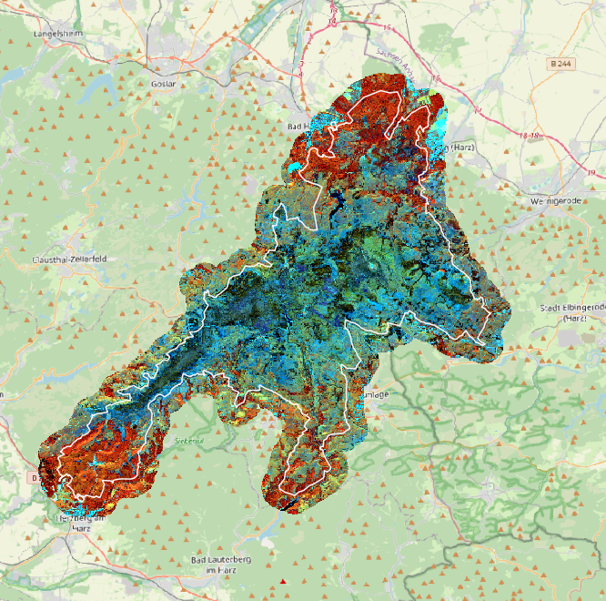
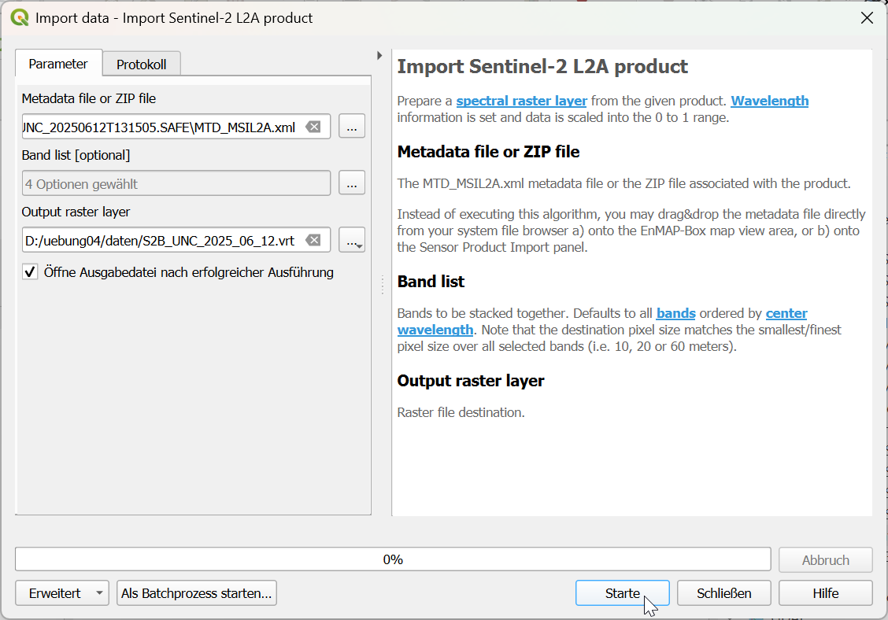
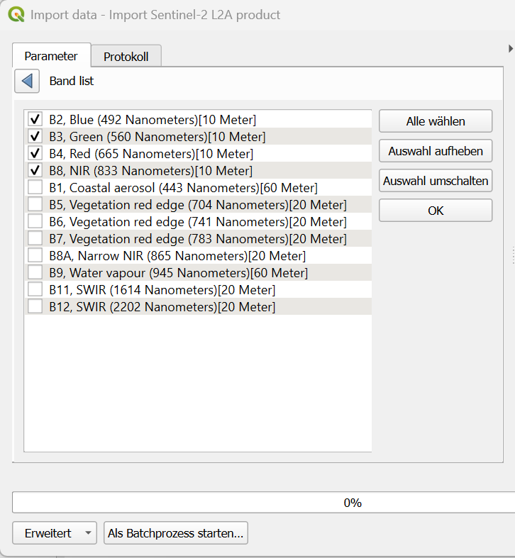

```{=html}
<!--

Skripte für die Übungen 04 des Moduls FPM08 Forstliche Fernerkundung im Studiengang
B.Sc. Forstwirtschaft an der HAWK Göttingen.

Autor: Paul Magdon
Datum: 2025-10-18
Letztes Update: 2026-10-13 (Hans Fuchs)
Lizenz: Creative Commons BY-NC-SA 4.0 https://creativecommons.org/licenses/by-nc-sa/4.0/

-->
```

# Lerneinheit 04: Erstellung einer Satellitenbildkarte des Harz Nationalparks {#sec-le04}



## Lernziele und Aufgabenstellung

Satellitenbilder stellen eine wichtige Grundlage in Fernerkundungsprojekten dar. Das
Copernicus-Programm der Europäischen Union betreibt eine Flotte von Erdbeobachtungssatelliten, die
zunehmend im forstlichen Monitoring verwendet werden. In dieser Einheit werden wir das Sentinel-2
Satellitensystem vorstellen und die Eigenschaften der verfügbaren Produkte diskutieren. Dazu soll
eine Satellitenbildkarte des Nationalpark Harz erstellt werden. Die Grenzen des NP Harz sollen für
die Internet-Präsenz auf aktuellen Satellitenbildkarten dargestellt werden. Diese können auch z.B.
als Grundlage für die Planung von Feldaufnahmen oder für die visuelle Erfassung einzelner Waldteile
dienen.

**Lernziele**

Die Studierenden sollen:

-   den Dataspace des Copernicus-Programms der Europäischen Raumfahrt Agentur (ESA) kennen lernen
-   lernen nach Sentinel-2 Satellitenbilder für bestimmte Regionen und Zeitpunkte zu suchen und
    herunterzuladen
-   die Ordnerstrukturen von Sentinel-2 Datenprodukten kennen lernen und die Satellitenbilder in
    QGIS importieren können.
-   Rasterdaten auf Untersuchungsgebiete zuschneiden können.

**Aufgaben**

1.  Suchen Sie im Copernicus Dataspace nach einer geeigneten Sentinel-2 Aufnahme vom Juni 2025 und
    laden Sie diese S2-Kachel herunter.
2.  Untersuchen Sie die Ordnerstruktur des Satellitenproduktes und importieren Sie die Bänder B02,
    B03, B04 und B08 mit einer räumlichen Auflösung von 10 m.
3.  Erstellen Sie ein CIR-Satellitenbildmosaik des NP-Harzes
4.  Schneiden Sie das Satellitenbildmosaik auf die Außengrenzen des NP Harz mit einem 1000m breiten Aussenpuffer zu und maskieren Sie alle Werte außerhalb.

## Aufgabe 0: Anlegen eine neuen QGIS-Projektes

Folgen Sie der Anleitung aus LE01 @sec-projekt_management, um eine neue Ordnerstruktur und ein neues
QGIS-Projekt für LE04 anzulegen.

## Aufgabe 01: Überprüfen der EnMAP-Box Installation (Optional)

Starten Sie die EnMAP-Box: `Raster` → `EnMAP-Box` →  `EnMAP-Box`

Wenn sich die EnMAP-Box nicht öffnet, wiederholen Sie bitte die Installation der EnMap-Box Erweiterung (s. @sec-epinstall) und/oder die Installation zusätzlicher Module (s. @sec-epmodulinstall).  

## Aufgabe 02: Recherche und Download eines aktuellen Sentinel-2 Satellitenbildes

Die Europäische Raumfahrt Agentur (ESA) stellt das gesamte Archiv der Copernicus Daten kostenfrei
als offenen Datensatz zur Verfügung. Zur Suche und für den Download solcher Daten wird das online
Datenportal <https://dataspace.copernicus.eu/> betrieben. Für die Nutzung des Portals ist eine
einmalige kostenfreie Registrierung notwendig, um einen Nutzernamen und ein Passwort zu erhalten.

Nach der erfolgreichen Registrierung kann ein Login auf der Homepage erfolgen. Für die Suche nach
Daten ("Explore Data") wird der Copernicus-Browser unter folgender URL angeboten:

<https://browser.dataspace.copernicus.eu>

Der Browser bietet umfangreiche Möglichkeiten, um nach Geodatenprodukten zu suchen. Ändern Sie  die englische Spracheinstellung im Copernicus Browser indem sie oben links auf EN klicken und Deutsch aus der Liste auswählen.

**Festlegen der Area of Interest (AOI)**

Hierfür können Polygone oder Multipolygone des Untersuchungsgebietes verwendet werden. Als Datenformat für die Definition der Geometrie akzeptiert der Copernicus-Browser das GeoJSON Format im Koordinatenreferenzsystem EPSG:4326 mit geographischen Längen- und Breitengraden. GeoJSON ist ein textbasiertes Format zum Speichern von Vektordaten (s. auch <https://de.wikipedia.org/wiki/GeoJSON>). Für die Übung soll das Grenzpolygon des NP-Harz genutzt werden. Das entsprechende GeoJSON kann hier
heruntergeladen werden:

<https://cloud.hawk.de/index.php/s/2Zg8raN2qsHMyZf>

Speichern Sie die Datei in Ihrem Projektordner im Unterordner *"daten"*. Sie kann sowohl
mit QGIS als auch mit einem Texteditor (z.B. Editor, WordPad, Notepad++) geöffnet werden.

Im Copernicus-Browser kann nun eine Area of Interest (AOI) angelegt werden.
Dazu rechts oben auf das Polygonsymbol  klicken und das Upload Icon  auswählen.
Mit Drag & Drop die GeoJSON Datei direkt von Dateimanager in den Browserbereich "Drop a file ..." ziehen.

{width="719"}

Nach dem erfolgreichen Upload wird die Außengrenze des Nationalparks Harz im Browser angezeigt.

::: callout-caution
Wenn die Dateigröße der GeoJON Datei 10MB überschreitet, wird die Datei nicht akzeptiert. In diesem Fall können

1.    die Geometrien vereinfacht werden mit `Vektor` -> `Geometrie Tools` -> `Vereinfachen` oder

2.    eine Bounding Box berechnet werden mit `Verarbeitung` -> `Werkzeugkiste` -> `Layerwerkzeuge` -> `Layerausdehnung extrahieren`
:::

**Auswahl und Download der gewünschten Produkte**

Auf der linken Seite des Browsers können die gesuchten Produkte spezifiziert werden. In der Lerneinheit arbeiten wir mit Produkten des Sentinel-2 Satelliten. Zusätzlich können Filter gesetzt werden.

-    Klicken Sie auf "Suche"

Wählen Sie den Produkttyp aus: 

-    Satellit: Sentinel-2
-    Sensor: MSI
-    Produkt: L2A (Surface Reflection)

Nutzen Sie den Slider um eine maximale Wolkenbedeckung zu definieren. 

- Max. Cloud Cover = **10%**

 Für die Übung suchen wir nach einer Aufnahme aus dem Juni 2025. Als Zeitraum, in welchem Bilder gesucht werden. Nach unten scrollen und im Abschnitt "Zeitraum:" setzen wir folgende Werte:

-   Von: *2025-06-01*

-   Bis: *2025-06-30*

Klicken Sie auf "Suche". Es wird eine Ergebnisliste angezeigt, die alle Aufnahmen enthält, die
unseren Kriterien entsprechen. Der gesamte Bereich des Nationalparks wird mit zwei Kacheln abgedeckt.
Für die Übung wählen wir die Kacheln vom **12.6.2025**:

-   *S2B_MSIL2A_20250612T102559_N0511_R108_T32UNC_20250612T131505.SAFE*

-   *S2B_MSIL2A_20250612T102559_N0511_R108_T32UPC_20250612T131505.SAFE*

Wählen sie diese Aufnahmen aus und beantworten sie mithilfe des Copernicus-Browsers folgende Fragen:

::: {style="border: 3px solid #ff8a0b; background-color: #ffffff; padding: 8px;"}
**Fragen:**

1.  *Um welche Uhrzeit wurde die Aufnahme gemacht?*

2.  *Wie hoch ist der Wolkenanteil der gesamten S2-Kachel?*

3.  *Welcher der drei Sentinel-2 Satelliten hat die Aufnahme gemacht?*

4.  *Welche Dateigröße hat eine S2-Kachel?*
:::

Laden Sie anschließend die beiden Kacheln herunter und speichern Sie die ZIP-Dateien
in Ihrem Projektordner unter "daten".

## Aufgabe 03: Import der Satellitendaten in QGIS {#sec-import-S2}

Die Satellitenprodukte werden von der ESA in einer standardisierten Struktur gespeichert und
ausgeliefert. Eine detaillierte Beschreibung der Produkte finden Sie in der Dokumentation unter:
<https://sentiwiki.copernicus.eu/web/s2-products>. Nach dem Entpacken der ZIP-Datei finden Sie
folgende Ordnerstruktur:

``` plaintext
S2B_MSIL2A_20250612T102559_N0511_R108_T32UNC_20250612T131505.SAFE/
├── DATASTRIP/
│   └── DATASTRIP/
|   └── DS_2BPS_20250612T131505_S20250612T103519/
├── GRANULE/
│   └── L2A_T32UNC_20250612T103519
|   |    └──AUX_DATA
|   |    └──IMG_DATA
|   |    |   └──R10m 
|   |    |   |   └──T32UNC_20250612T102559_AOT_10m.jp2
|   |    |   |   └──T32UNC_20250612T102559_B02_10m.jp2
|   |    |   |   └──T32UNC_20250612T102559_B03_10m.jp2
|   |    |   |   └──T32UNC_20250612T102559_B04_10m.jp2
|   |    |   |   └──T32UNC_20250612T102559_B08_10m.jp2
|   |    |   |   └──T32UNC_20250612T102559_TCI_10m.jp2
|   |    |   |   └──T32UNC_20250612T102559_WVP_10m.jp2
|   |    |   └──R20m 
|   |    |   └──R60m 
|   |    └──QI_DATA
|   <    └──MTD_TL.xml
├── HTML/
├── rep_Info/
├── inspire.xml
├── manifest.safe
├── MTD_MSIL2A.xml
├── S2B_MSIL2A_20250612T102559_N0511_R108_T32UNC_20250612T131505-ql.jpg  
```

::: callout-caution
In einigen Fällen kommt es beim Entpacken zur Fehlermeldung "Dateiname zu lang". In diesem Fall
benennen sie die beiden ZIP-Ordner vor dem Entpacken in "bild_1" und "bild_2" um.
:::

Fügen Sie die Bänder **B02, B03, B04 und B08** mit einer räumlichen Auflösung von 10m zu ihrem
QGIS-Projekt hinzu.

::: {style="border: 3px solid #ff8a0b; background-color: #ffffff; padding: 8px;"}
Ordnen sie den folgenden Bandnummern des Sentinel-2 MSI eine der Beschreibungen der Spektralbereiche zu:  `Coastal aerosol, Blue, Green, Red, Red edge1, Red edge2, Red edge3, Narrow NIR, NIR, Water vapour, SWIR1, SWIR 2`

B02 =

B03 =

B04 =

B08 =
:::

## Aufgabe 04: Erstellen eines CIR-Falschfarbenbildes

Nach dem Import der einzelnen Bänder werden diese als Graustufenbilder dargestellt. Um eine
Farbdarstellung zur ermöglichen, müssen die Bänder als Mehrkanalfarbild zusammengestellt werden (s. auch LE02 @sec-mehrkanalbilder). Erstellen Sie für beide Kacheln ein virtuelles Mehrkanalraster
und speichern sie diese unter:

-   *S2B_MSIL2A_20250612T102559_N0511_R108_T32**UNC**\_20250612T131505.vrt*

-   *S2B_MSIL2A_20250612T102559_N0511_R108_T32**UPC**\_20250612T131505.vrt*

Erstellen sie anschließend ein virtuelles Satellitenbildmosaik und stellen Sie es in QGIS als
CIR-Bild dar. Folgen Sie dazu auch der Anleitung aus der LE02 @sec-mosaikieren.

::: {style="border: 3px solid #ff8a0b; background-color: #ffffff; padding: 8px;"}
**Vergleichen sie die CIR-Darstellung innerhalb und außerhalb des Nationalparks:**

*1.) Welche Unterschiede in den Farben / Reflexion können sie feststellen?*

*2.) Wie interpretieren Sie diese Unterschiede im Bezug auf die Vegetationsbedeckung im Nationalpark und im bewirtschafteten Wald?*

Zur Beantwortung der 2. Frage ist es hilfreich das aktuelle DOP20 Luftbild der LGLN einzubinden.
Siehe dazu auch @sec-wms in LE03.
:::

## Aufgabe 05: Zuschneiden des Satellitenbildmosaiks {#sec-zuschneiden}

Die beiden originalen S2-Kacheln decken jeweils ca. 100 x 100km ab. Der Bereich ist also deutlich größer als der gesamte Harz. Um diesen Bereich zu verkleinern sollen die Satellitenbilder auf den Nationalpark zugeschnitten werden. Um die Grenzbereiche trotzdem gut darstellen zu können, soll ein Puffer mit der Breite von 1000m um die Außengrenze des Parks gelegt werden.

**Außengrenze Puffern**

Speichern Sie das GeoJSON der Nationalparkgrenze als **Geopackage**, transformiert in ein metrisches UTM-Koordinatenreferenzsystem, im Unterordner `daten` ab. Achten Sie darauf, dass das Koordinatenbezugssystem auf das metrische UTM Koordinatenreferenzsystem `EPSG:25832` gestellt ist. Puffern Sie anschließend mit einer Breite von 1000 m.

**Bild zuschneiden und maskieren**

Zum Maskieren und zuschneiden nutzen Sie anschließend die Funktion:

::: {style="border: 2px solid #afca0b; background-color: #fafafa; padding: 8px;"}
`Raster` →`Extraktion` → `Raster auf Layermaske zuschneiden`
:::

Speichern Sie das neue Raster unter dem Namen *NP_Harz_2025_06_12* als GeoTIFF im Unterordner `daten` ab und laden Sie die Satellitenbildkarte als CIR-Falschfarbenbild in QGIS. Überlagern Sie das Bild mit der Außengrenze des Nationalparks.

## Aufgabe 06: Import von Sentinel Satellitenbilder mit der EnMAP-Box (Optional)

Die EnMap-Box enthält die praktische Funktion

`Verarbeitung` -> `Werkzeugkiste` -> `Import data` -> `Ìmport Sentinel-2 L2A product`,

die die Aufgabe 03 @sec-import-S2 vereinfacht. Es braucht nur die ZIP-Datei mit den originalen L2A-Daten entpackt werden. Im `.SAFE` Ordner befindet  sich die Metadaten-Datei `MTD_MSIL2A.xml`, die ausgewählt oder direkt mit drag & drop vom Dateimanager auf das `Import Sentinel-2 L2A product` Panel gezogen werden kann.
Aus einer Liste lassen sich dann verschiedene Bänder auswählen, die in einem Mehrkanalbild zusammengeführt werden.

- Wählen Sie aus der **Band list** die Bänder B2, B3, B4, B8.

::: {#fig-import_s2 layout-ncol=2}
{#fig-a width="100%"}

{#fig-b width="80%"}

Import von Sentinel-2 Daten in der EnMAP-Box 
:::

- Als **Output raster layer** definieren Sie eine Datei zum Speichern als im Format **VRT**. 

Die ausgewählten Bänder werden mit der kleinsten Pixelgröße der ausgewählten Bänder resampled. Wellenlängenbereiche und Bandnamen werden als Metadaten gleich automatisch in die Ausgabe-Rasterdatei geschrieben.

- Sehen Sie sich das virtuelle Mehrkanalbild als CIR-Falschfarbendarstellung an.

## Aufgabe 07: Erstellen eines Kartenlayouts zur Ausgabe einer Satellitenbildkarte

Erstellen Sie ein Layout für eine Satellitenbildkarte in den Grenzen des Harz Nationalparks mit dem Hintergrund  **"basemap.de Grau"** (s. @sec-basemap_vektorkachel) zur Ausgabe im Format PDF mit den wichtigsten Kartenelementen (s. @sec-kartenlayout).


## Aufgabe 08: Projekt bereinigen und sichern

Nachdem wir das Satellitenbild mosaikiert und zugeschnitten haben, können wir die originalen
Satellitenbilder aus dem Projekt entfernen und auch aus dem Ordner `daten` löschen. Sie brauchen nur
die Vektor-Geopackages und die Datei *NP_Harz_2025_06_12.tif*  zu behalten. Speichern sie dann das QGIS-Projekt, schließen sie QGIS und kopieren sie den Projektordner von `D:\` in Ihr persönliches Laufwerk.
