```{=html}
<!--

Skripte für die Übungen 05 des Moduls FPM08 Forstliche Fernerkundung im Studiengang
B.Sc. Forstwirtschaft an der HAWK Göttingen.

Autor: Paul Magdon
Datum: 2025-11-01
Letztes Update: 2026-10-25 (Hans Fuchs)
Lizenz: Creative Commons BY-NC-SA 4.0 https://creativecommons.org/licenses/by-nc-sa/4.0/

-->
```

# Lerneinheit 05: Aktualisierung der Waldeinteilung auf Basis von Ortholuftbildern

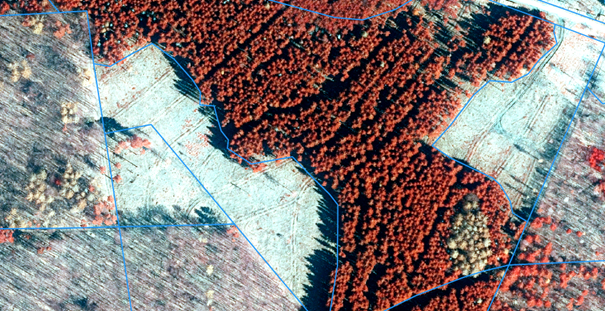{width="658"}

## Lernziele und Aufgabenstellung

Aufgrund der langanhaltenden und ausgeprägten Trockenheit in den Jahren 2017 und 2018 kam es zu großflächigen
Waldschäden. Davon betroffen ist auch das Forstamt Heiligenstadt in Thüringen. Im Rahmen der regelmäßigen Forsteinrichtung werden die aktuellen Bestandesgrenzen und die Waldeinteilung mithilfe von Luftbildern und im Gelände überprüft. Aufgrund der Schäden haben sich im
FoA Heiligenstadt - gegenüber der letzten Einrichtung im Jahr 2012 - einige Änderungen in der
Bestockung der Bestände ergeben. In der Übung sollen anhand von aktuellen Luftbildern diese
Änderungen erfasst und die Waldeinteilung des Forstbetriebes aktualisiert werden.

**Lernziele**

Die Studierenden sollen:

-   Passende Luftbilder des FoA Heiligenstadt in Thüringen beschaffen

-   Prinzipien des Digitalisierens von Geo-Objekten kennen

-   Fortgeschrittene Editierfunktionen nutzen, um die Waldeinteilung unter Einhaltung einer sauberen
    Vektortopologie zu aktualisieren

**Aufgaben**

1.  Beschaffen Sie sich CIR-Ortholuftbilder aus dem Geoportal Thüringen

2.  Beschaffen Sie sich die Waldeinteilung Thüringens aus dem Geoportal des Landesbetriebes ThüringenForst und filtern Sie diese mit den Abteilungen des FoA Heilligenstadt

3.  Beschaffen Sie sich Informationen zur satellitenbasierten Waldschadenserfassung als WMS-Geodatendienst des Geoportals des Landesbetriebes ThüringenForst

4.  Erstellen Sie auf Basis dieser Informationen eine aktualisierte Waldeinteilung

## Aufgabe 0: Anlegen eine neuen QGIS-Projektes

Folgen sie der Anleitung aus LE01 @sec-projekt_management, um eine neue Ordnerstruktur und ein neues
QGIS-Projekt für LE05 anzulegen. In der Übung bietet es sich an, den Ordner "daten" weiter in die
Unterordner "vektor" und "raster" zu unterteilen.

## Aufgabe 01: Recherche und Download aktueller Ortholuftbilder {#sec-le05_download}

Im ersten Schritt laden wir aktuelle Luftbilder des Geoportals Thüringen unter folgendem Link
herunter:

<https://geoportal.thueringen.de/gdi-th/download-offene-geodaten/download-luftbilder-und-orthophotos>

Der Teil des FoA, den wir bearbeiten, wird durch folgende Kacheln abgedeckt:

-   32580_5691

-   32580_5692

-   32581_5691

-   32581_5692

Für diese Kacheln liegen digitale Orthophotos (DOP) aus einer Befliegung vom 28.4.2021 vor. Die
Waldeinteilung, die momentan vorliegt, fand zum Stichtag 1.1.2012 statt. Insofern wäre eine Befliegung
aus dem Jahr 2022 im zehnjährigen Rhythmus. Trotz der Abweichung von einem Jahr zum nächsten
Stichtag (1.1.2022) sind die Daten für die Aktualisierung der Waldeinteilung geeignet.

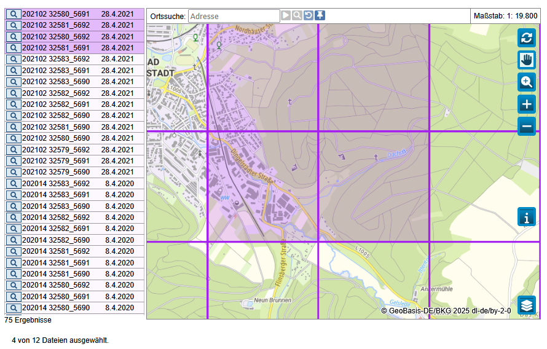

Nach dem Download können sie die ZIP-Ordner entpacken und die vier Luftbilder in den Ordner
./daten/raster kopieren. Nach dem erfolgreichen Entpacken können die ZIP-Ordner aus dem
Projektverzeichnis gelöscht werden.

Importieren sie die Ortholuftbilder und erzeugen sie eine CIR-Falschfarbendarstellung (siehe auch
LE02 @sec-CIR_darstellung).

::: callout-tip
**Stil kopieren**

Wenn Sie den Layernamen im Layer-Panel markieren, können Sie mit der Funktion *"Rechtsklick \> Stile > Stile kopieren" und "Stile einfügen“* die Symbolisierung von einem Layer auf den anderen übertragen.
:::

::: {style="border: 3px solid #ff8a0b; background-color: #ffffff; padding: 8px;"}
**Fragen:**

1.  *An welchem Datum wurden die Luftbildaufnahmen gemacht?*

2.  *In welchem Koordinatenbezugssystem liegen die Ortholuftbilder vor?*
:::

## Aufgabe 02: Import und Filterung der bestehenden Waldeinteilung {#sec-le05_filter}

Der Landesbetrieb ThüringenForst stellt umfangreiche forstliche Geodaten kostenfrei zur Verfügung.
Unter anderem werden Daten zur Waldeinteilung und Bestockung zur Verfügung gestellt, die wir in der
Übung verwenden wollen. Diese Daten können im ESRI-Shapefile Format unter folgendem Link für ganz
Thüringen heruntergeladen werden:

<https://geomis.geoportal-th.de/geonetwork/srv/ger/catalog.search#/metadata/1f690892-d1c3-436a-819e-a26d207e17d7>

Entpacken sie die Dateien dieses Shapefiles in den Ordner *"../daten/vektor/"* und fügen sie die
Waldeinteilung in das QGIS-Projekt ein.

Für die Übung beschränken wir uns auf die Auswertung folgender Abteilungen des FoA Heiligenstadt
(55):

Abt. 24, 25, 26, 27, 29, 30, 32.

Daher werden die Vektordatensätze entsprechend ausgewählt und gefiltert. QGIS bietet Selektions- und Filterungswerkzeuge an. In der Übung verwenden wir das Filterwerkzeug, mit dem Vektordaten über Attribute gefiltert werden können. Als Syntax
für den Filteraufruf wird die Datenbankprogrammiersprache Structured Query Language (SQL) verwendet.
Da wir die Auswertung auf oben genannte Abteilungen beschränken wollen, können wir folgenden SQL-Befehl für
die Filterung verwenden:

``` sql
"FOA"=55 AND "ABT" IN ('24','25','26','27','28','29','30','32')
```

Zur Aktivierung der Abfragefunktion markieren wir im Layer-Panel den Layer „Baumarten“ und
 *„Rechtsklick \> Filter“*. In dem sich öffnenden Fenster können wir unten unter
„Datenanbieterspezifischer Filterausdruck“ den oben genannten SQL Filterausdruck eintragen.
Anschließend können Sie über die Funktion „Testen“ überprüfen, ob der Filter funktioniert. Es
sollten 60 Zeilen ausgegeben werden. Ist dies der Fall aktivieren wir den neuen Filter mit „OK“.

Für die spätere Bearbeitung der Geometrien legen wir uns eine Kopie der gefilterten Bestände an und
speichern diese im Geopackage Format ab. Dazu klicken wir im Layer-Panel rechts auf den Layer
*„Baumarten“* und wählen die Funktion *„Export“* \> *„Gewählte Objekte speichern als“*. Wir speichern die
Objekte als Geopackage im Ordner „.../vektor/“ unter dem Namen „uebung05.gpkg“ ab und nennen den
Layer „Waldeinteilung“.

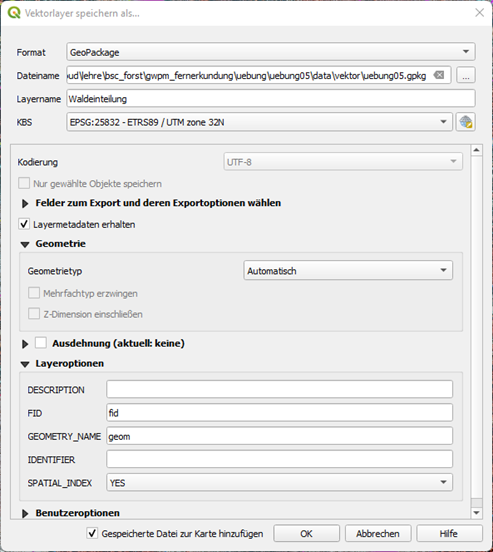

Für die weitere Bearbeitung soll die Darstellung der Waldeinteilung angepasst werden, so dass eine
Aktualisierung mithilfe visueller Interpretation erfolgen kann. Dazu sollen zunächst das CIR-Luftbild mit den Bestandesgrenzen als kontrastreiche Linien überlagert werden. Hier bietet sich
als Symbollayertyp *„Rand: Einfache Linie“* mit einem hellen Blauton an. Wir können die
Symbolisierung unter Layer -\> Eigenschaften -\> Symbolisierung einstellen.

Für die Aktualisierung der Waldeinteilung benötigen wir eine zusätzliche Spalte mit einer
Bestandesnummer. Wir können diese hinzufügen, in dem wir die Attributtabelle des neuen Layers
öffnen. Nun aktivieren wir den Editiermodus mit dem kleinen Stiftsymbol   und wählen „Neue Spalte
hinzufügen" 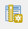.

::: {style="border: 3px solid #ff8a0b; background-color: #ffffff; padding: 8px;"}
**Waldeinteilungsdaten**

1.) Welcher Stichtag hat die vorliegende Waldeinteilung?

2.) Welche Waldflächeninformationen enthält der Datensatz?
:::

## Aufgabe 03: Import von Informationen zu Waldschäden

ThüringenForst stellt außerdem die Ergebnisse einer satelliten-basierten Waldschadenserfassung zur
Verfügung. Hierbei werden in einem automatisierten Verfahren Vitalitätsänderungen in Sentinel-2
Satellitenbildzeitreihen erfasst. Die räumliche Auflösung der Sentinel-2 Satellitenbilder beträgt
10m. Die Ergebnisse der Waldschadenskartierung werden zusammen mit anderen interessanten
Informationen als WMS-Geodatendienst unter folgender URL zur Verfügung gestellt:

``` html
https://www.geoproxy.geoportal-th.de/geoproxy/services/forst/FORST
```

Richten sie WMS-Verbindung in QGIS ein und laden sie den Layer "Waldschäden" (s.a. @sec-wms in LE03).

## Aufgabe 04: Aktualisierung der Waldeinteilung

### Editieren von Vektordaten

Bevor wir mit der Aktualisierung der Bestandesgrenzen beginnen können, müssen wir zunächst die
verschiedenen Werkzeuge zum Editieren von Polygonen kennenlernen. Um topologische Fehler beim
Editieren der Geometrien zu reduzieren, verwenden wir die „Einrastwerkzeuge“(snapping) in QGIS. Bei
der ersten Verwendung müssen wir diese zunächst aktivieren/sichtbar machen. Dazu wählen wir:

::: {style="border: 2px solid #afca0b; background-color: #fafafa; padding: 8px;"}
`Ansicht`→`Werkzeugleisten`→`Einrastewerkzeugleiste`
:::

In der Werkzeugleiste erscheint nun ein kleines Magnetsymbol . Wir aktivieren die Einrastfunktion
durch Klick auf das Magnet-Symbol und wählen folgende Einstellungen:

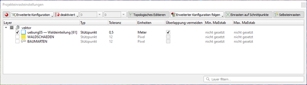

Zusätzlich nutzen wir die *erweiterten Digitalisierungswerkzeuge* in QGIS. Bei der ersten
Verwendung müssen wir diese wie folgt aktivieren:

::: {style="border: 2px solid #afca0b; background-color: #fafafa; padding: 8px;"}
`Ansicht`→`Werkzeugleisten`→`Erweiterte Digitalisierungswerkzeugleiste`
:::

QGIS bietet vielfältige Funktionen zum Editieren von Geometrien an. In dieser Übung wollen wir nur
die wichtigsten vorstellen:

#### Polygon teilen

Wir können bestehende Polygone in zwei oder mehrere Teile zerschneiden. Diese Funktion ist immer
dann sinnvoll, wenn z.B. ein schon kartierter Bestand aufgrund von Störungen weiter aufgeteilt
werden soll. Wir markieren  den zu bearbeitenden Polygon-Layer im Layer-Panel und klicken im Menü auf das  Stiftsymbol, um den Editiermodus zu aktivieren. Jetzt können wir das Tool 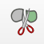 „Objekte zerteilen“  in der Werkzeugleiste „Erweiterte Digitalisierungswerkzeuge“ wählen.

::: callout-caution
Bevor sie mit dem Zerteilen starten, achten Sie darauf, das kein Polygon ausgewählt ist.
:::

::: callout-note
Wenn sie die Funktion 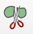 „Teile zerlegen“  wählen, wird ein Polygon in ein Multipolygon aufgeteilt. Es entsteht keine neue Zeile in der Attributtabelle!
:::

Anschließend können wir ein Polygon zerteilen, in dem wir mit der Maus eine Trennlinie einzeichnen
und diese nach dem letzten Stützpunkt mit einem Rechtsklick bestätigen. Vorteil dieses Verfahrens
ist, dass keine Zwischenräume oder Selbstschneidungen entstehen. In der Attributtabelle wird eine
neue Zeile mit den gleichen Werten angelegt. Hier müssen wir noch die Bestandesnummer ändern und in
der neue Spalte „Bestand“ eine Zahl eintragen. Dies geht mit dem 
  Editierwerkzeug, das sich im Hauptmenü in der Werkzeugleiste befindet.
Nach Öffnen der Attributtabelle können Sie  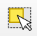 "Objekte wählen" aktivieren, in das neue Polygon klicken und die Attribute des ausgewählten Polygons anpassen.

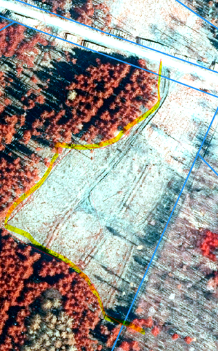


#### Polygongrenzen verschieben

Um die Grenzen eines bestehenden Polygons zu ändern, verwenden wir das 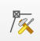 Stützpunktwerkzeug . Nach
Auswahl des Werkzeuges klicken wir einmal in das zu ändernde Polygon. Daraufhin erscheinen die
Grenzen und Stützpunkte dieses Polygons. Mit Linksklick kann ein einzelener Stützpunkt ausgewählt und mit
der Maus verschoben werden. Durch Doppelklick auf die Grenzlinie können neue Stützpunkte hinzugefügt
werden. Stützpunkte können mit der Taste „Entf“ oder mit dem Mülleimer-Symbol gelöscht werden.

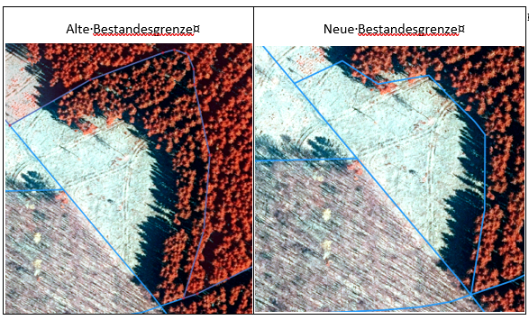
#### Polygone vereinen

In Fällen, in denen Bestandesgrenzen aufgelöst werden müssen, können die Bestände vereint werden.
Dazu werden zunächst die Polygone, die vereint werden sollen, mit dem  Auswahlwerkzeug in der
Werkzeugleiste selektiert. Zum Selektieren mehrerer Polygone halten sie die Shift-Taste beim Klicken
gedrückt! Anschließend können wir das Werkzeug  „Objekte verschmelzen“  wählen und im Dialogfeld entscheiden, welche Attribute für das verschmolzene Polygon übernommen werden sollen.

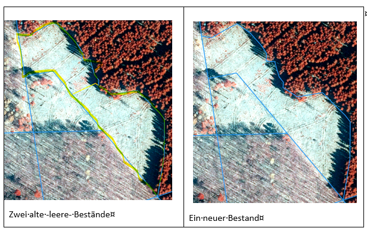

### Aktualisierung der Waldeinteilung im FoA-Heiligenstadt

Nachdem wir nun die wichtigsten Funktionen zum Editieren von Geometrien kennengelernt haben, sollen
Sie den Umgang mit diesen Funktionen üben und die Waldeinteilung der ausgewählten Bestände
aktualisieren. Gehen Sie dabei systematisch vor, in dem Sie jede Abteilung einzeln bearbeiten.

::: callout-tip
*Erstellen Sie eine Kopie des Waldeinteilungslayers und setzen Sie den Symbolisierungswert auf
„Abt“. Dann sehen Sie sofort, welche Bestände zu einer Abteilung gehören. Alternativ können Sie auch
mit Filtern arbeiten.*
:::

ThüringenForst veröffentlicht Anweisungen für die Forsteinrichtung. Im Kapitel 4.1
„Flächengliederung des Forstbetriebes“ sind Hinweise für die Aktualisierung der Waldeinteilung
enthalten. Zum Beispiel werden Mindestgrößen für Bestände (0.1ha) angegeben. Sie finden diese
Anweisung im StudIP im Ordner „Literatur“. Konsultieren sie die Anweisungen, wenn sie Entscheidungen
beim Digitalisieren treffen müssen.
