```{=html}
<!--

Skripte für die Übungen 06 des Moduls FPM08 Forstliche Fernerkundung im Studiengang
B.Sc. Forstwirtschaft an der HAWK Göttingen.

Autor: Paul Magdon
Datum: 2025-11-06
Letztes Update: 2026-10-28 (Hans Fuchs)
Lizenz: Creative Commons BY-NC-SA 4.0 https://creativecommons.org/licenses/by-nc-sa/4.0/

-->
```

# Lerneinheit 06: Erfassung von Fraßschäden in Kiefernbeständen

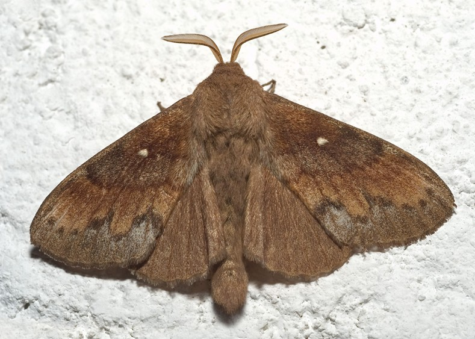

## Lernziele & Aufgabenstellung

Die Nordwestdeutsche Forstliche Versuchsanstalt (NWFVA) überwacht in Niedersachsen großflächige
Fraßschäden des Kiefernspinners (*Dendrolimus pini*, Abbildung 1) mithilfe von
Fernerkundungsverfahren. Im Juli 2013 wurde dazu eine Luftbildbefliegung durchgeführt und digitale
Orthophotos (DOP) hergestellt. In dieser Lerneinheit sollen Schwerpunkte der
Kiefernspinnerverbreitung in Kiefernwäldern des Wendlandes (Landkreis Lüchow-Dannenberg) kartiert
werden. Grundlage der Kartierung verschiedener Fraßintensitäten ist ein DOP mit einer räumlichen
Auflösung von 20 cm (DOP20).

**Lernziele**

Die Studierenden sollen:

-   Luftbilder für die Schadenkartierung aufbereiten
-   Vegetationsindizes berechnen
-   Schadflächen digitalisieren

**Aufgaben**

1.  Rasterdaten importieren und als CIR darstellen
2.  Berechnung des Normalized Difference Vegetation Index (NDVI)
3.  Durchführung einer Kontraststreckung und Erstellen einer Farbpalette
4.  Digitalisierung der Schadflächen

## Aufgabe 0: Anlegen eine neuen QGIS-Projektes

Folgen sie der Anleitung aus LE01 @sec-projekt_management um eine neue Ordnerstruktur und ein neues
QGIS-Projekt für LE05 anzulegen. In der Übung bietet es sich an den Ordner "daten" weiter in die
Unterordner "vektor" und "raster" zu unterteilen.

## Aufgabe 01: Download und Import der Ortholuftbilder

Nachdem wir das Projekt angelegt haben, soll das Luftbild aus der Befliegung der NWFVA importiert
werden. Laden Sie zunächst die Geodatensätze für die Übungen herunter. Sie finden diese hier:

<https://cloud.hawk.de/index.php/s/WffowNpbeg4qajB>

Kopieren & entpacken Sie sich diesen Ordner.

Bei dem Bild handelt es sich um ein Digitales Orthophoto (DOP) mit vier Bändern:

-   Band 1 (rot)
-   Band 2 (grün)
-   Band 3 (blau)
-   Band 4 (nir, Nahes Infrarot)

Importieren sie die Ortholuftbilder in ihr QGIS-Projekt und erzeugen Sie eine
CIR-Falschfarbendarstellung (siehe auch LE02 @sec-CIR_darstellung).

**Fragen:**

::: {style="border: 3px solid #ff8a0b; background-color: #ffffff; padding: 8px;"}
1.  *Welche räumliche Auflösung hat das Luftbild?*
2.  *Welche radiometrische Auflösung hat das Luftbild?*
:::

## Aufgabe 02: Berechnung des Normalized Difference Vegetation Index (NDVI)

Zur besseren Ansprache der Vitalität/des Blattverlusts berechnen wir den Normalisierten Differenz-VegetationsIndex (NDVI) nach der folgenden Formel:

$$
\text{ndvi} = \dfrac{\text{nir} - \text{rot}}{\text{nir} + \text{rot}}
$$
Für die Berechnung nutzen wir den `Raster` → `Rasterrechner`:

Die Liste "Rasterkanäle" enthält alle geladenen Bänder, die verwendet werden können. Um ein Rasterband zum Feld für den Rasterberechnungsausdruck hinzuzufügen, doppelklicken Sie auf den Bandnamen in der Liste "Felder". Sie können dann die Operatoren verwenden, um Berechnungsausdrücke zu formulieren, oder Sie können sie einfach in das Feld eingeben. Vergessen Sie nicht die Klammern!
Als Ergebnis definieren Sie den `Ausgabelayer: sub_prezelle_2013_ndvi` mit Angabe des Speicherpfades und das `Ausgabeformat: GeoTIFF`.

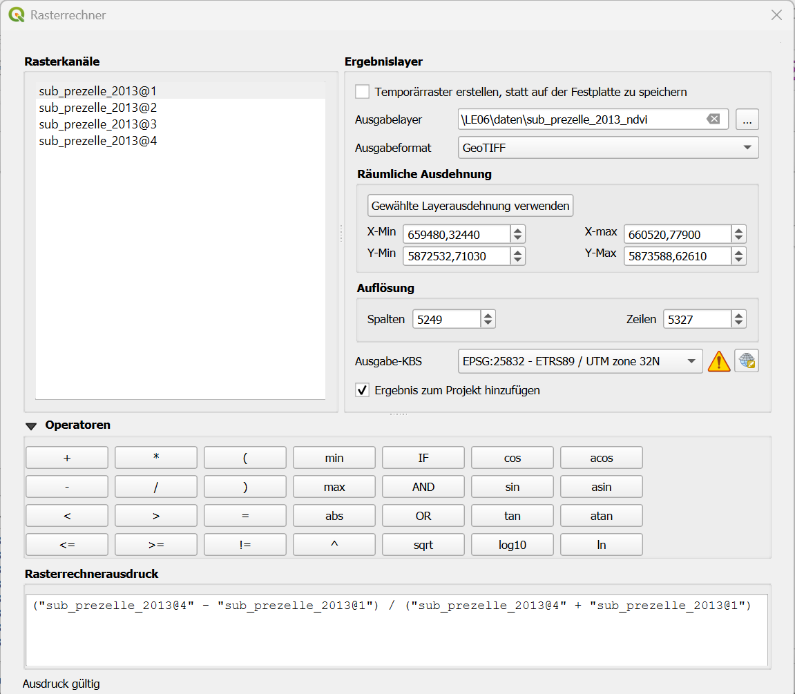

Als Ausgabe erhalten wir ein Graustufenbild mit den NDVI Werten im Bereich -1 ≤ Pixelwert ≤1 (s. unten)

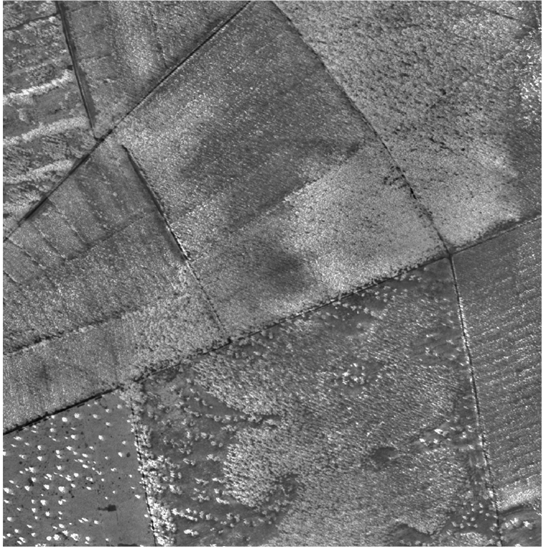

::: {style="border: 3px solid #ff8a0b; background-color: #ffffff; padding: 8px;"}
**NDVI**

-   *Welche Unterschiede gibt es zwischen einer CIR-Falschfarbendarstellung und NDVI Darstellung??*
-   *Was ist der kleinste und was der größte NDVI-Wert?*
-   *Welche NDVI-Werte haben geschädigte, welche gesunde Kiefern?*
-   *Sind allen niedrigen NDVI-Werte auf Fraßschäden zurückzuführen?*
:::

## Aufgabe 03: Bildverbesserung

### Kontraststreckung

Der NDVI hat einen theoretischen Wertebereich von \[-1;1\].Histogramme können genutzt werden, um die
Verteilung der NDVI-Werte zu überprüfen. Zum Erstellen des Histogramms gehen wir auf
*Layereigenschaften -\> Histogramm -\> Berechnen*

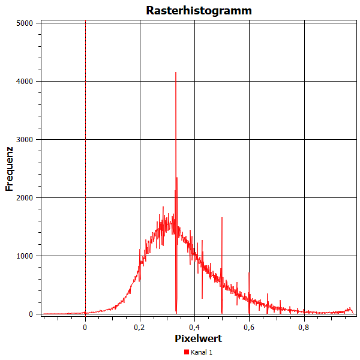{width="491"}

Das Histogramm zeigt eine typische Verteilung der NDVI-Werte über Vegetationsoberflächen. Es ist
deutlich zu erkennen, dass der Wertebereich nicht vollständig abgedeckt wird. Die meisten Pixel
liegen in Wertebereich von 0.1-0.8. Diese Information können wir nutzen um mithilfe einer
Kontraststreckung die Qualität des Bildes zu erhöhen. Dazu schneiden wir die unteren 0.2 % und
oberen 2% der Verteilung ab (Tail-clipping) und strecken den Rest der Werte auf den gesamten
Wertebereich.

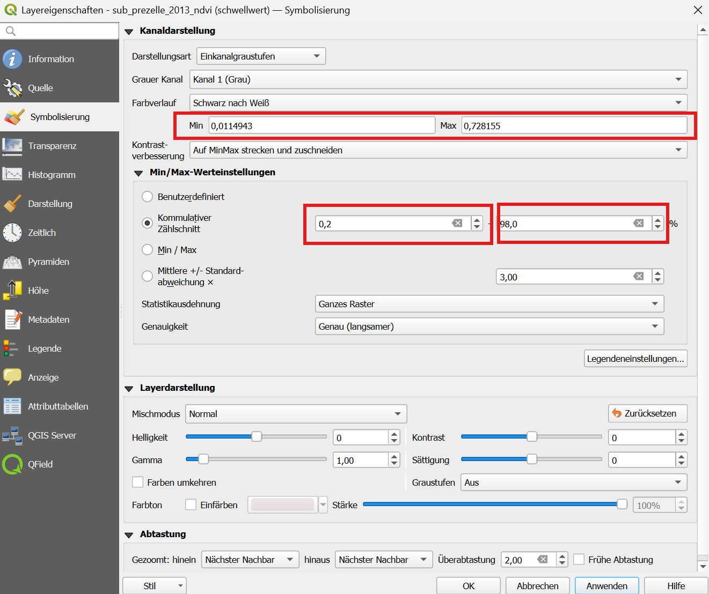

### Farbpaletten

Für die Kartierung der Schadflächen kann es sinnvoll sein, die Darstellung der NDVI-Karte nicht als
Graustufenbild darzustellen, sondern dafür ein Farbpalette zu nutzen. Erstellen sie dafür einen
neuen Stil mit einer kontrastreichen Farbpalette. Stellen Sie dazu die Darstellungsart unter
*Layereigenschaften -\> Symbolisierung auf Einkanalpseudofarben* und wählen sie einen eigneten Farbverlauf
aus.

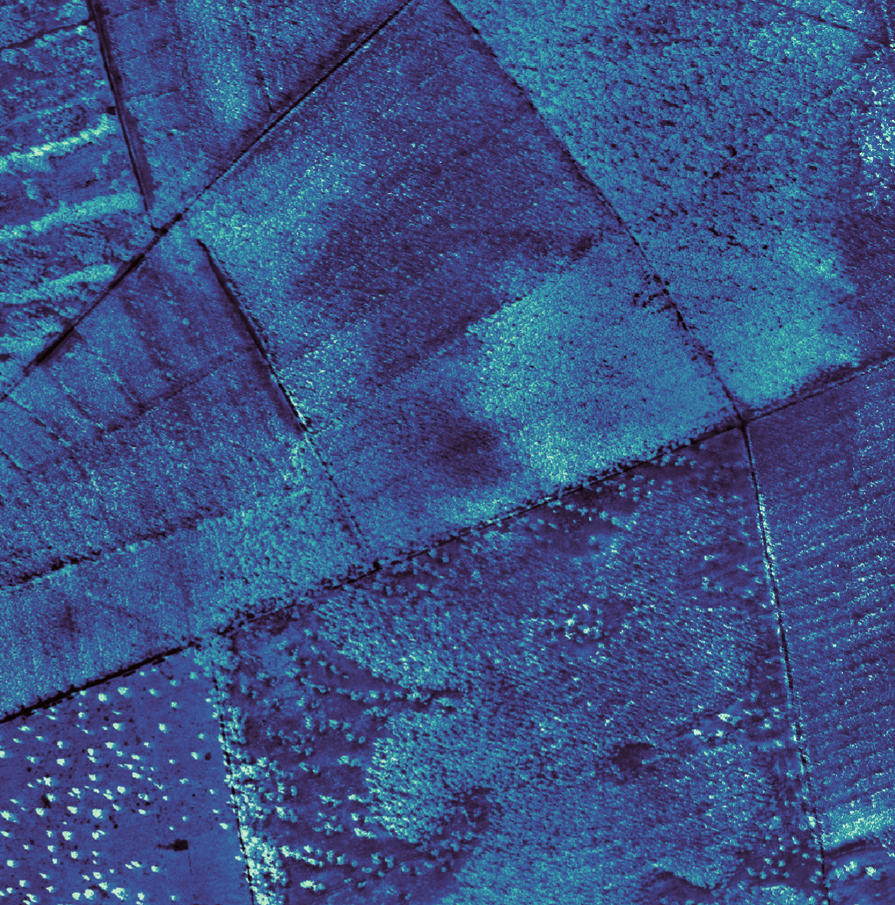{width="709"}

## Aufgabe 04: Digitalisierung der Schadflächen

Im nächsten Schritt sollen die vom Kiefernspinner befallen Flächen digitalisiert werden. Legen Sie
dazu ein neues Geopackage im Ordner *"daten/vektor"* mit dem Namen *uebung06.gpkg* an. In dem
Geopackage wird ein neuer Layer mit dem Namen "Schadflächen" angelegt werden.

Erfassen sie anschließend die Bereiche, die Sie eindeutig als befallen erkennen können als Polygone
und bestimmen Sie die Flächengröße der Schadflächen.

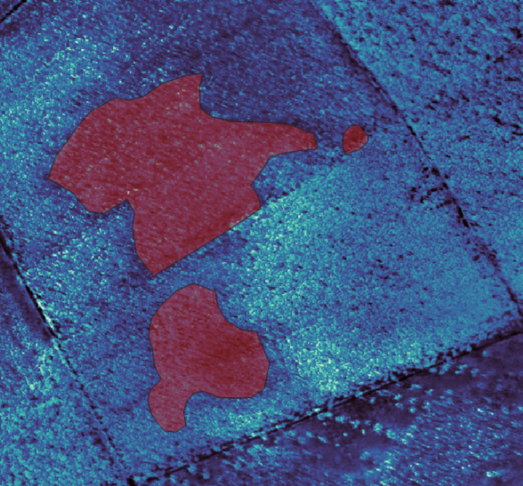


## Aufgabe 05: Digitaliserung der Schadflächen mit der EnMAP-Box (optional)

Die EnMAP-Box bietet nützliche Werkzeuge, die Workflows wie z.B. visuelle Interpretation und Kartierung von Referenzdaten auf Grundlage von Ortholuftbildern erleichtern.

### Import von Rasterdaten in die EnMAP Box
- Starten Sie die EnMAP-Box mit Klick auf   
Das Ortholuftbild `sub_prezelle_2013.tif` kann mit Klick auf 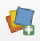 oder auf 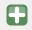 geladen werden. Wenn das Orthobild noch in der QGIS Kartenansicht geladen ist können wir auch mit 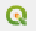 importieren.

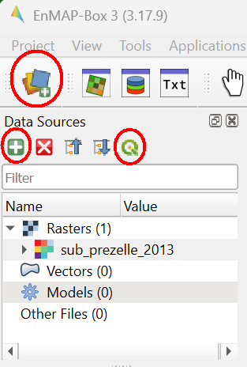

- Zum Darstellen einer Falschfarbenkomposite markieren wir den Layernamen in der EnMAP-Box. Rechtsklick auf den Layernamen, `Open in new map` → `CIR`.


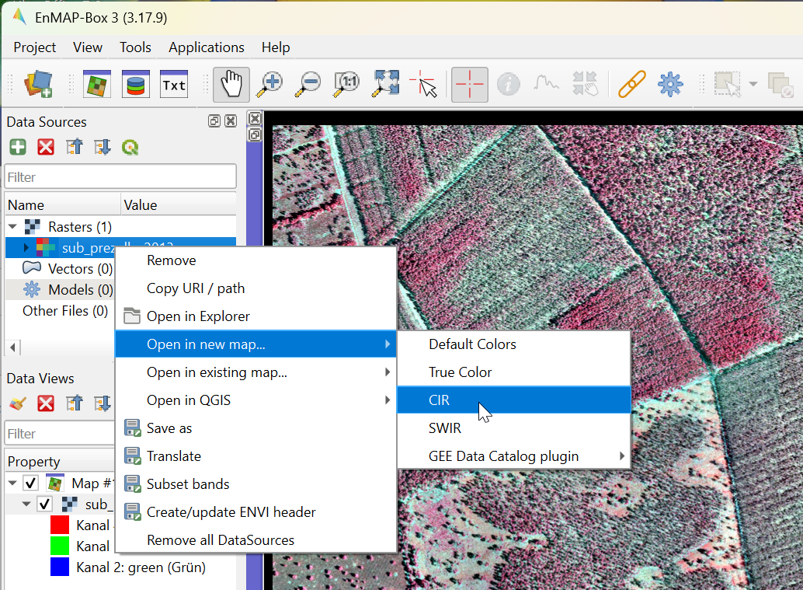

### NDVI Berechnung
- Öffnen Sie `Applications` → `Raster math`. Klicken Sie auf den Reiter `Code snippets`. - Doppelklick auf `Indices` und `ndvi` öffnet ein Fenster zur Berechnung des NDVI. 
- In der Auswahliste *Select source for placeholder "raster"* wählen Sie `sub_prezelle_2013` aus. Auf `OK` und `Starte` klicken.

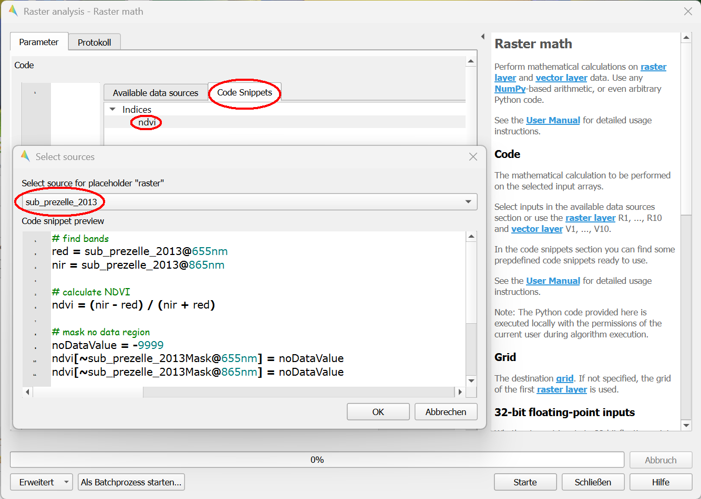

- Ein neuer Layer `ndvi` erscheint unter `Data sources`. Rechtsklick auf den Layernamen `Open in new map` → `default`. Es sind jetzt zwei Map Views geöffnet. 
- Mit Klick auf  und Link 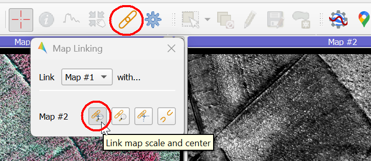 sind beide Map Views geometrisch synchronisiert. - Aktivieren Sie Map View #2, mit dem Identify Tool  können einzelne Pixelwerte abgefragt werden.

### Farbpalette
- Mit Klick auf 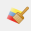 öffnet sich ein Fenster zur Änderung der Rasteransicht.
- Wählen Sie den Reiter `Pseudo` und übertrage die Minimum- und Maximum-Werte aus dem Reiter `Gray` auf den Reiter `Pseudo`. 
- Klicken Sie auf den kleinen Pfeil neben der Color Ramp und wähle `Farbverlauf invertieren`. 

### Vektorisierung
- Importiere die neuerstellte Vektordatei `uebung06.gpkg` in die EnMAP Box.
- Rechtsklick auf den Vektorlayernamen `Open in existing map`→ `Map #1`
- Markiere den Vektor-Layernamen unter `Data Views`
- Mit Klick auf `Toggle editing` und `Add new polygon` können weitere Schadflächen kartiert werden.

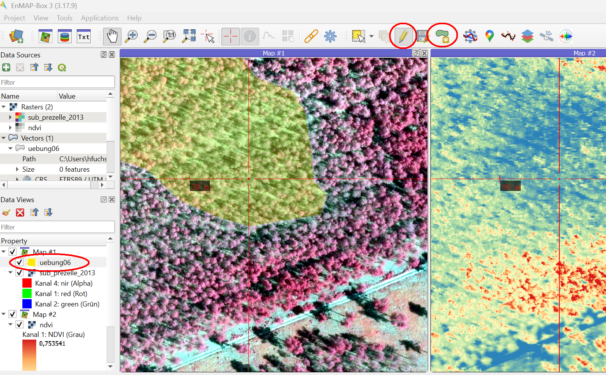

## Aufgabe 06: Entwicklung der Schadflächen (Optional)

Die bisherigen bearbeiteten Aufnahmen stammen aus dem Jahr 2013. Im Mai 2024 hat das niedersächsische Landesamt für Geoinformation und Landesvermessung (LGLN) erneut
eine Befliegung der Flächen vorgenommen. Laden Sie sich die beiden Orthobildkacheln für das
Untersuchungsgebiet vom Geoportal des LGLN herunter (s. @sec-ortho_download) und vergleichen sie den Stand 2024 mit 2013.

::: {style="border: 3px solid #ff8a0b; background-color: #ffffff; padding: 8px;"}
\[**Zeitliche Änderungen**\]

-   Lassen sich Schadflächen von 2013 auch in den Orthobildern 2024 erkennen?

-   Welche Schlüsse für die Waldbewirtschaftung lassen sich aus dem Vergleich der Jahre 2013 und
    2024 ziehen?
:::
