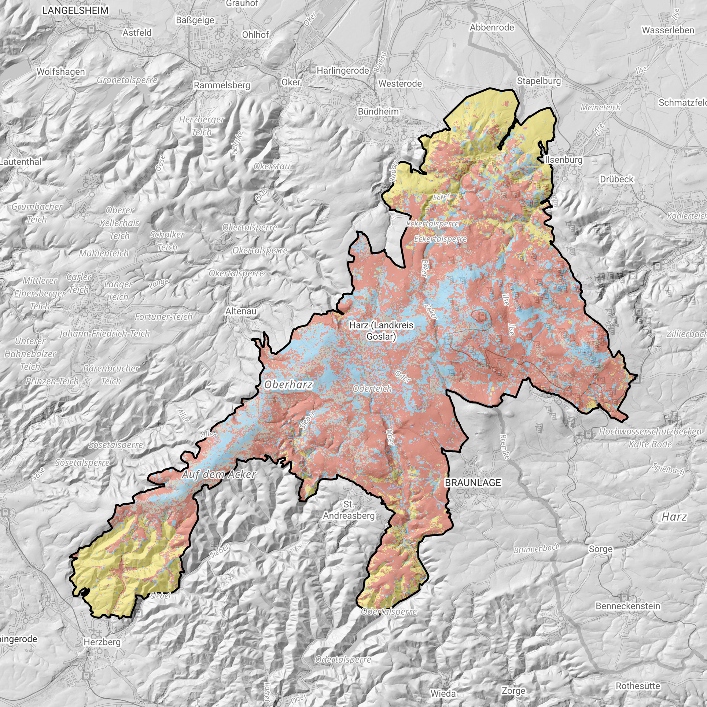
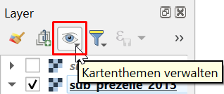
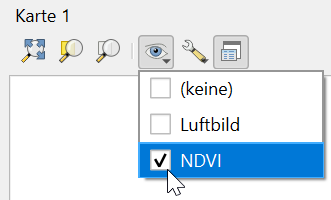
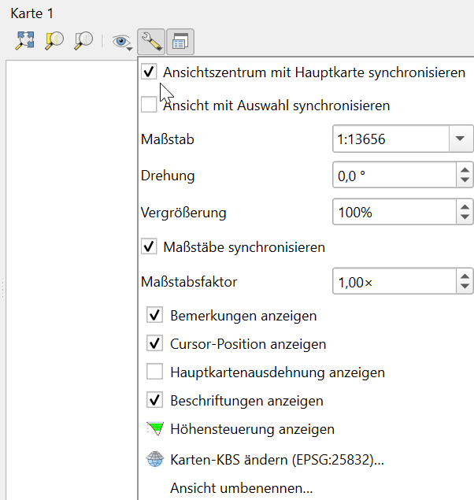
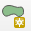
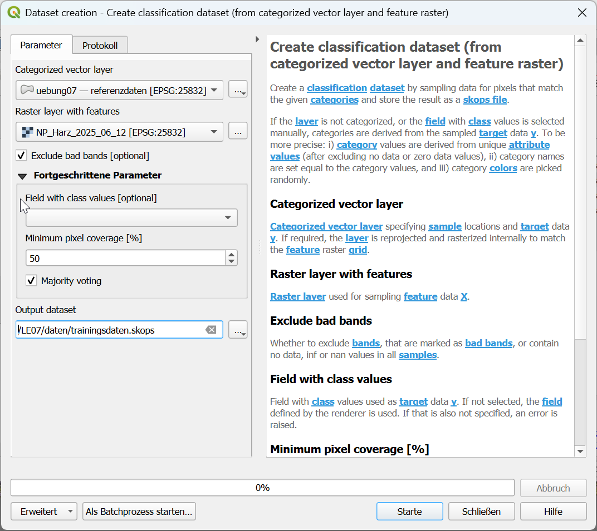
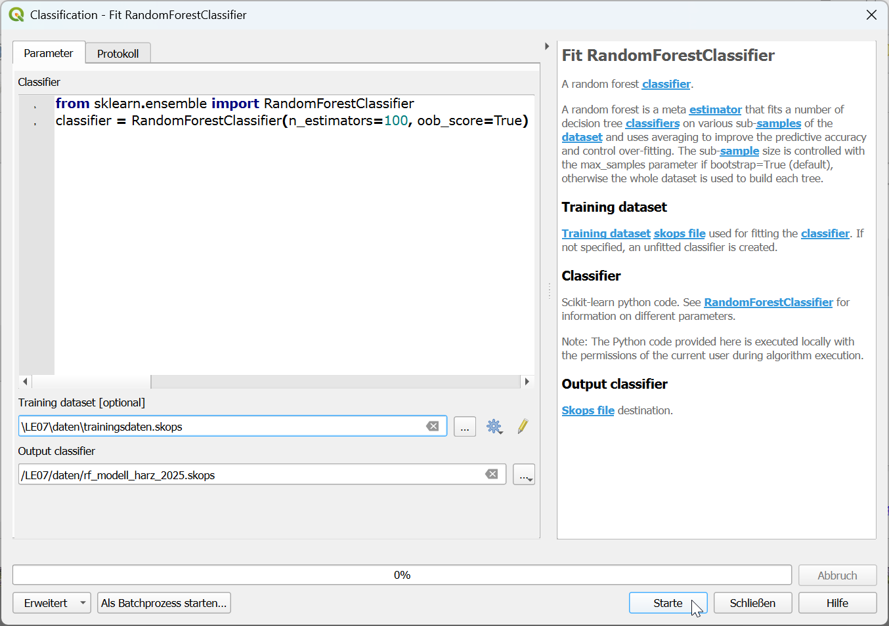
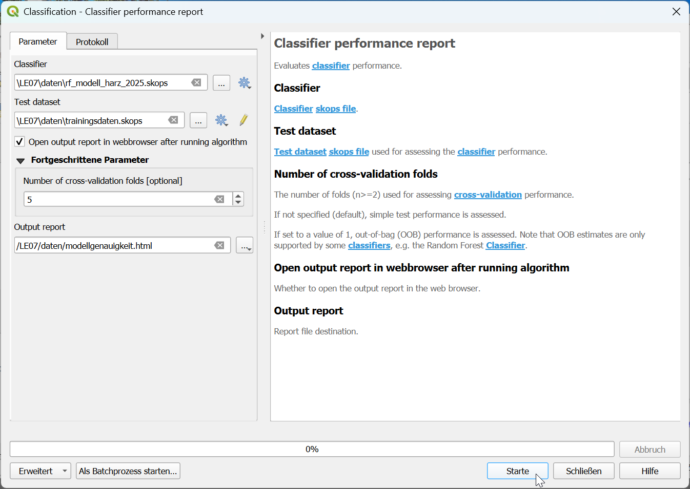
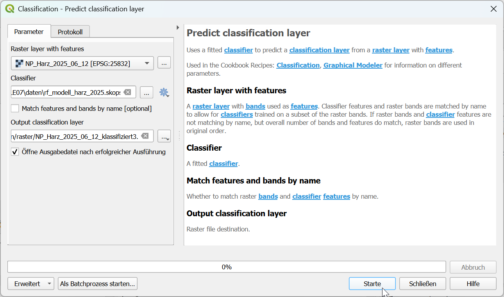

```{=html}
<!--

Skripte für die Übungen 07 des Moduls FPM08 Forstliche Fernerkundung im Studiengang
B.Sc. Forstwirtschaft an der HAWK Göttingen.

Autor: Paul Magdon
Datum: 2025-11-16
Lizenz: Creative Commons BY-NC-SA 4.0 https://creativecommons.org/licenses/by-nc-sa/4.0/

-->
```

# Lerneinheit 07: Waldtypenklassifikation im Nationalpark Harz {#sec-le07}


{fig-align="center"}

## Lernziele und Aufgabenstellung

In dieser Übung soll für den Nationalpark Harz eine einfache Waldtypenkarte für das Jahr 2025
erstellt werden. Dazu werden aktuelle Satellitenbilder des Satellitensystems Sentinel-2
mit einem überwachten Klassifikationsverfahren automatisiert klassifiziert.

::: callout-note
Die Übung dient der Demonstration grundlegender Prinzipien der überwachten Bildklassifikation.
Es ist nicht das Ziel eine genaue Waldtypenkarte für spätere Auswertungen zu erstellen. Dies würde
ein deutlich höherer Aufwand erfordern, besonders bei der Auswahl von Trainingsgebieten, und somit
den zeitlichen Rahmen dieser Übung sprengen.
:::

**Lernziele**

Die Studierenden sollen:

-   Trainingsdaten für Bildklassifikationen anlegen
-   Maschinelle Lernverfahren zum Erstellen von Klassifikationsmodellen nutzen
-   Mithilfe von trainierten Klassifikationsmodellen Satellitenbilder klassifizieren, um einfache
    Landbedeckungskarten zu erstellen.

**Aufgaben**

1.  Raster- und Vektordaten importieren
2.  Ergänzung von Trainingsdaten durch visuelle Interpretation von Ortholuftbildern
3.  Trainieren eines RandomForest Klassifikationsmodelles
4.  Klassifikation eines S2-Satellitenbildes zur Erstellung einer Waldtypenkarte

## Aufgabe 0: Anlegen eine neuen QGIS-Projektes

Folgen Sie der Anleitung aus LE01 @sec-projekt_management, um eine neue Ordnerstruktur und ein neues
QGIS-Projekt für LE07 anzulegen. In der Übung bietet es sich an, den Ordner *"daten"* weiter in die
Unterordner *"vektor"* und *"raster"* zu unterteilen.

## Aufgabe 01: Überprüfen der Plugin-Installation

Starten Sie die EnMAP-Box: `Raster` → `EnMAP-Box` →  `EnMAP-Box`

Wenn sich die EnMAP-Box nicht öffnet, wiederholen Sie bitte die Installation der EnMap-Box Erweiterung (s. @sec-epinstall) und/oder die Installation zusätzlicher Module (s. @sec-epmodulinstall).

Überprüfen Sie mit `Erweiterung` → `Geobasis Loader` ob das Geobasis_Loader Plugin installiert ist. Wenn nicht, bitte neu installieren (s. @sec-install_geobasis).

## Aufgabe 01: Download und Import der Geodaten

### Hintergrund-Basiskarten
 Laden Sie aus dem Geobasis Loader Katalog 1: Deutschland/Germany:
 
 1. `Deutschland` → `DE: basemap.de Raster HillShade (WMS)` mit dem KBS "ETS89 / UTM Zone 32N (EPSG:25832)"
 2. `Deutschland` → `DE: basemap.de grau (WFS)` mit KBS "WGS84 / Pseudo Mercator (EPSG:3857)
 
     Markieren Sie den Layer "basemap. de grau" im Layer-Panel.
     `Rechtsklick` → `Eigenschaften` → `Symbolisierung` → `Layereigenschaften`
     
     Stellen sie die Deckkraft mit dem Schieberegler auf ca. 40%.
 
### **Luftbilder**

Für die Erstellung der Trainingsdaten sollen Luftbilder mit einer höheren räumlichen Auflösung
genutzt werden. Da der Nationalpark Harz in zwei Bundesländern liegt, müssen von beiden Bundesländern
entsprechende DOP-Bilder als WMS eingebunden werden.

Laden Sie aus dem Geobasis Loader Katalog 1: Deutschland/Germany:

1. `Sachsen-Anhalt` → `ST: Digitale Orthophotos - DOP20 (WMS)` mit dem KBS "ETS89 / UTM Zone 32N (EPSG:25832)"
2. `Sachsen-Anhalt` → `ST: DOP -Kachelübersicht-Überfliegungsdatum (WMS)` mit dem KBS "ETS89 / UTM Zone 32N (EPSG:25832)"
3. `Niedersachsen`  → `NI: Digitale Orthophotos - DOP20 (WMS)` mit dem KBS "ETS89 / UTM Zone 32N (EPSG:25832)"


### **Satellitenbilder**

In dieser Übung sollen aktuelle Sentinel-2 Satellitenbilder für die Klassifikation verwendet werden.
In LE04 @sec-le04 haben wir bereits eine Satellitenbildkarte angelegt und die entsprechenden
Sentinel-2 Bilder beschafft und vorbereitet. Kopieren Sie sich das Bild **NP_Harz_2025_06_12.tif**
aus der Übung LE04 in den Ordner "daten/raster" der akuellen Übung (LE07). Sollten Sie keinen Zugriff auf
dieses Bild haben, können Sie es sich alternativ hier herunterladen:

<https://cloud.hawk.de/index.php/s/FHap7J8Ge3iKa89>

Bei dem Bild handelt es sich um ein Sentinel-2 Satellitenbild vom 12.06.2025 mit folgenden vier
Bändern:

-   Band 1: B02 Blue
-   Band 2: B03 Green
-   Band 3: B04 Red
-   Band 4: B08 NIR

Importieren Sie das Satellitenbild in Ihr QGIS-Projekt und erzeugen Sie eine
CIR-Falschfarbendarstellung (siehe auch LE02 @sec-CIR_darstellung). Achten Sie darauf "0" als
Leerwert zu setzen. Führen sie anschließend eine Kontraststreckung mit einer zweifachen mittleren
Standardabweichung durch.

**Fragen:**

::: {style="border: 3px solid #ff8a0b; background-color: #ffffff; padding: 8px;"}
1.  *Welche räumliche Auflösung hat das Satellitenbild?*
2.  *Welche radiometrische Auflösung hat das Satellitenbild?*
3.  *An welchem Datum wurden das Satellitenbild und die Luftbilder in Sachsen-Anhalt und Niedersachsen
    aufgenommen?*
:::

### Vektordaten

Für die Übung werden zwei Vektordatensätze benötigt:

1. Grenze des Nationalpark Harz, die Sie hier herunterladen können:

<https://cloud.hawk.de/index.php/s/Hs52DFGtPnfKzyN>

2. Vorbereiteter Referenzdatensatz mit Polygonen der verschiedenen Waldtypen

<https://cloud.hawk.de/index.php/s/ox2CsrEDHNjiiyF>

Für die Darstellung und Klassifizierung der Waldtypen ist eine qml-Stildatei sehr wichtig, die bereits vorbereitet ist und die
Sie hier herunterladen können:

<https://cloud.hawk.de/index.php/s/TBSk6Xi27JpMQLA>

- Importieren sie die Vektordaten. 
- Markieren Sie den Layer "uebung07" im Layer-Panel.
- Laden Sie die QGIS-Stildatei "waldtypen_np_harz_vektor.qml"
- `Rechtsklick` → `Eigenschaften` → `Symbolisierung` → `Stil` →  `Lade Stil`
- Stellen sie die Deckkraft der Layerdarstellung mit dem Schieberegler auf ca. 50%.

## Aufgabe 02: Ergänzung der Referenzdaten
Zur gleichzeitigen Darstellung des Satellitenbildes und der Luftbilder bereiten wir zwei
Kartenansichten vor.

Aktivieren Sie im Layer-Panel **nur** die Layer:

1. "uebung07 - referenzdaten"
2. "nlp-harz - Aussengrenze"
3. NI: Digitale Ortophotos - DOP20 (WMS)
4. ST: Digitale Ortophotos - DOP20 (WMS)

- Legen Sie eine neue Kartenansicht im Layer-Panel an mit dem Namen **"Luftbild"** mit "Kartenansicht
  verwalten -\> Thema hinzufügen..."



Aktivieren Sie jetzt im Layer-Panel **nur** diese Layer:

1. "uebung07 - referenzdaten"
2. "nlp-harz - Aussengrenze"
3. "NP_Harz_2025-06_12"
4. DE: basemap.de grau (WFS)
5. DE: basemap.de Raster Hillshade (WMS)

 Mit "Kartenansicht verwalten -\> Thema hinzufügen..." fügen Sie eine neue
  Kartenansicht mit dem Namen **"Sentinel-2"** hinzu.

- Im Hauptmenü `Ansicht` → `Neue Kartenansicht` einen zweiten Viewer mit dem Namen "Karte 1" öffnen.
  Ordnen Sie Hauptansicht und Ansicht "Karte 1" so an, dass beide Fenster gleich gross nebeneinander
  platziert sind.
  
- Wählen Sie in Ansicht "Karte 1" das Kartenthema "Luftbild" aus.



- Aktivieren Sie in den Ansichtseinstellungen der "Karte 1" die Optionen "Ansichtszentrum mit
  Hauptkarte synchronisieren" und "Maßstäbe synchronisieren".



- Aktivieren Sie den Editiermodus des Vektor-Layers "uebung07" mit dem Stiftsymbol
  , Klicken Sie auf
  "Polygonobjekt hinzufügen". 
  
### Klassifikationschlüssel

Der Klassifikationsschlüssel legt fest, welche Landbedeckungs-/Landnutzungsklassen in der
thematischen Karte erfasst werden sollen. Er enthält üblicherweise auch eine detaillierte
Beschreibung wie die einzelnen Klassen definiert sind und wie sie erfasst werden sollen. Für diese
Übung soll eine einfache Unterscheidung von drei Waldtypen und einer Hintergrundklasse ausreichend
sein:

| Name              | Erläuterung                  | Klasse |
|-------------------|------------------------------|--------|
| Nadelholz         | Lebende, vitale Nadelgehölze |    1   |
| stehendes Totholz | Stehende tote Bäume          |    2   |
| Laubholz          | Lebende, vitale Laubgehölze  |    3   |
| Freiflächen       | Flächen ohne stehende Bäume  |    4   |

### Trainingsdaten ergänzen

Um eine überwachte Bildklassifikation durchführen zu können werden Referenzdaten benötigt. Die
Referenzdaten dienen zur Parametrisierung des Klassifkationsmodells, bzw. bei nicht-parametrischen
Verfahren zum Trainieren des Klassifikationsmodells. Die Anlage der Referenzdaten hat dabei eine
enorme Bedeutung für die Qualität der Klassifizierung und der daraus resultierenden thematischen
Karte. Es ist daher wichtig, eine ausreichende Anzahl qualitativ hochwertiger Referenzdaten
vorzubereiten. Für die Übung beschränken wir uns aus Zeitgründen auf 25 Polygone pro Klasse.

Der Layer Referenzdaten im Geopackage *uebung07.gpkg* enthält bereits für alle vier Klassen des
Klassifikationsschlüssels jeweils 20 Polygone als Trainingsdaten. Ergänzen sie den Datensatz, um
jeweils fünf weitere Polygone pro Klasse. Nutzen Sie für die visuelle Auswahl und Anlage der Polygone die synchronisierte 
Hauptkartenansicht (Sentinel-2) und Karte 1 (Luftbild).

Achten sie dabei auf folgende Aspekte:

- die Trainingsdaten sollten verteilt über das ganze Gebiet des Nationalparks liegen.

- als Trainingsdaten sollten Gebiete gewählt werden, die eindeutig der jeweiligen Klasse
    zugeordnet werden können. Randpixel, die verschiedene Landbeckungsklassen abdecken, sollten vermieden werden.

- die Trainingsdaten sollten die Variabillität der Spektralbereiche der jeweiligen Klassen
    möglichst abdecken.

- ein Trainingspolygon sollte etwa 10 - 100 Pixel enthalten.

- die Anzahl der Trainingspolygone bzw. der Trainingspixel pro Klasse sollte in etwa gleich sein.

## Aufgabe 03: Training eines Klassifikationsmodells {#sec-rf_training}

Die Trainingsdaten liegen als Vektordaten vor, die Klassenzugehörigkeit ist in der Attributtabelle gespeichert. Um diese Information zum Trainieren eines Klassifkationsmodelles zu nutzen, müssen wir diese in ein spezielles Serialisierungs- und Speicherformat ("skops") umwandeln, das für maschinelles Lernen entwickelt wurde.

EnMAP-Box stellt hierfür die Funktion *„Create classification dataset (from categorized vector layer and feature raster)“* zur Verfügung, die wir in der Werkzeugkiste der Verarbeitungsfunktionen über das Suchfeld finden können. In dieser Funktion setzen wir die folgenden Optionen:

-   **Categorized Vector Data**: Hier wählen wir das Geopackage "uebung07" mit den Referenzdaten.

-   **Raster layer with features**: Hier geben wir das Sentinel2-Bild "NP_Harz_2025-06_12.tif" an.

Klicken Sie auf `Fortgeschrittene Parameter`.

-   **Field with class labels**: Hier **kein** Feld auswählen und frei lassen. Die Klassenwerte und -namen werden dann aus der qml-Stildatei der Vektordaten eingelesen.

-   **Output dataset**: Hier geben wir an, wo die Trainingsdaten gespeichert werden sollen. Wir wählen *„trainingsdaten.skops“* im Ordner *"daten"*.



Jetzt können wir mit der Werkzeugkistenfunktion *„Fit RandomForestClassifier“* ein Klassifikationsmodell anpassen mit den folgenden Optionen:

-   **Training dataset**: Hier geben wir die Datei *„trainingsdaten.skops“* an.

-   **Output classifier**: Hier geben wir an, wo das trainierte Klassifikationsmodell gespeichert werden soll. Wir wählen *„rf_modell_harz_2025.skops“* im Ordner *"daten"*.





Mit der Werkzeugkistenfunktion *„Classifier Performance“* können wir statistische Kennzahlen zur Beurteilung der Modellgenauigkeit berechnen mit den Optionen:

-   **Classifier**: Hier geben wir das das Klassifikationsmodell *„rf_modell_harz_2025.skops“* an.

-   **Test dataset**: Hier geben wir wieder unsere Trainingsdaten  *„trainingsdaten.skops“* an.

Klicken Sie auf `Fortgeschrittene Parameter`.

-   **Number of cross-validation folds**: Hier geben wir die Anzahl der Kreuzvalidierungsfaltungen ein: z.B. *"5"*

-   **Output report**: Hier geben wir an, wo der Bericht über Modellgenauigkeit gespeichert werden soll. Wir wählen *„modellgenauigkeit.html“* im Ordner *"daten"*.


Nach Ausführen der Funktion öffnet sich ein Bericht mit Fehlermatrix und Statistiken, die wir in der nächsten Lehreinheit besprechen werden.  

## Aufgabe 04: Klassifikation eines S2-Satellitenbilds zur Erstellung einer Waldtypenkarte {#sec-rf_inference}

Nachdem wir das *RandomForest* Klassifikationsmodell trainiert haben, können wir es auf das gesamte
Satellitenbild anwenden, um jedem Pixel eine unsere vier thematischen Klassen zuzuweisen. Dazu
verwenden wir die EnMAP-Box-Funktion *Predict classifcation layer*, die im Werkzeugkasten der Verarbeitungsfunktionen zu finden ist. Hier werden folgende Optionen gewählt:

-   **Rasterlayer with features**: Hier geben wir unser Sentinel2-Bild an.

-   **Classifier**: Wir geben das vorher trainierte Modell *„rf_harz_2025_modell.skops“* an.

-   **Output classifcation layer**: Hier geben wir den Speicherpfad der thematischen Rasterkarte im Format GeoTiff ein unter *"daten/NP_Harz_2025_06_12_Waldtypen.tif"*.



Nach erfolgreicher Klassifikation wird das Bild als Raster mit indizierter Palette mit Graustufen im QGIS geladen. Prüfen Sie jetzt nochmal, ob das Koordinatenreferenzsystem des Projektes immer noch korrekt ist.

Anschließend schneiden wir das klassifizierte Bild auf auf die Grenzen des Nationalparks zu (siehe
dazu auch LE04 @sec-zuschneiden). Das zugeschnittene Bild wird als GeoTIFF unter *"daten/
NP_Harz_2025_06_12_Waldtypen.tif"* gespeichert. Für die Darstellung sollen die Farbwerte der
Pixel identisch zu den Farben des Vektor-Referenzdatensatz sein. Erstellen sie dafür eine entsprechende Symbolisierung.

**Fragen:**

::: {style="border: 3px solid #ff8a0b; background-color: #ffffff; padding: 8px;"}
1.  *Vergleichen sie die thematische Karte mit dem Satellitenbild.  Was fällt Ihnen auf?*
2.  *Bei welchen thematischen Klassen funktioniert die Klassifikation besser, bei welchen
    schlechter?*
3.  *Gibt es Bildbereiche/Regionen, in denen die Klassifikation genauer zu sein scheint?*
:::
