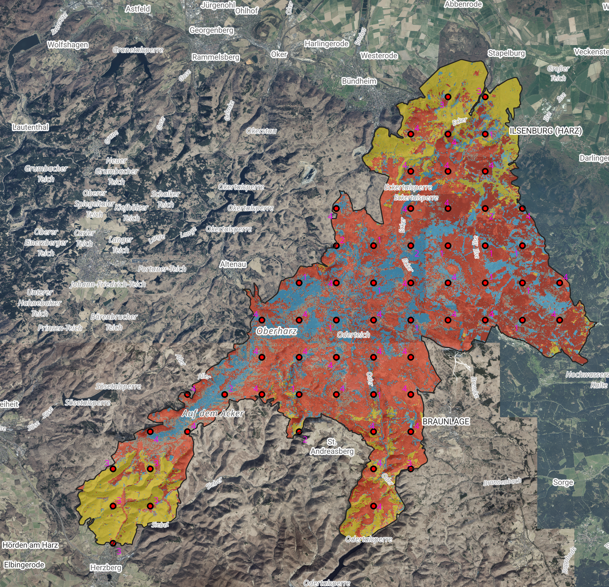
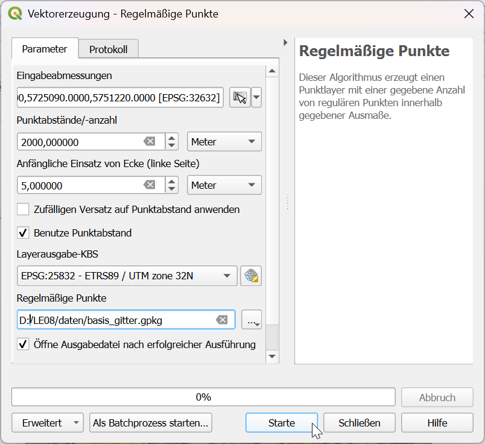
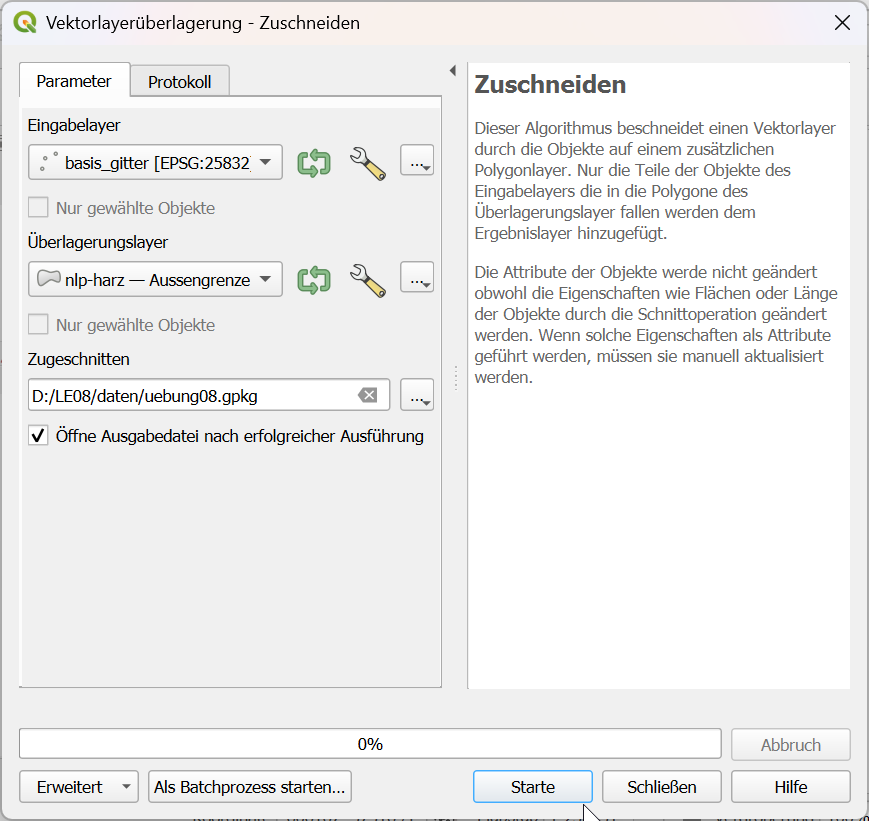
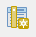
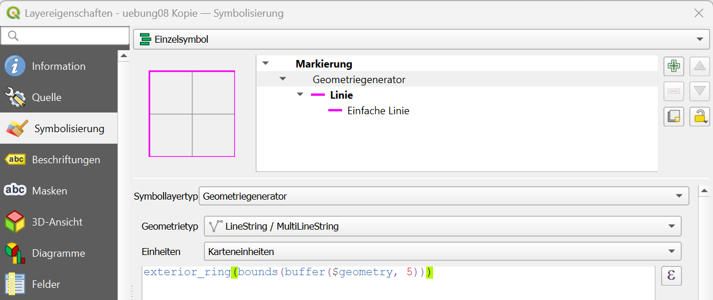
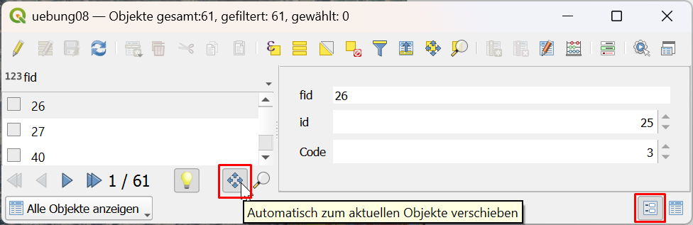
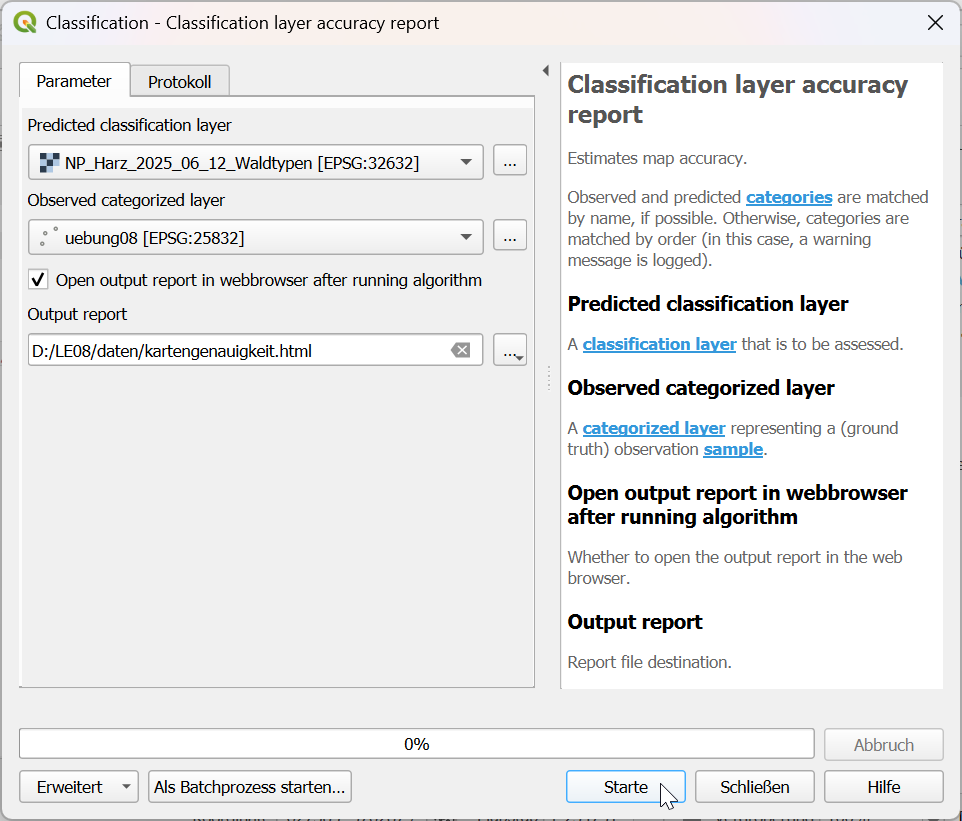
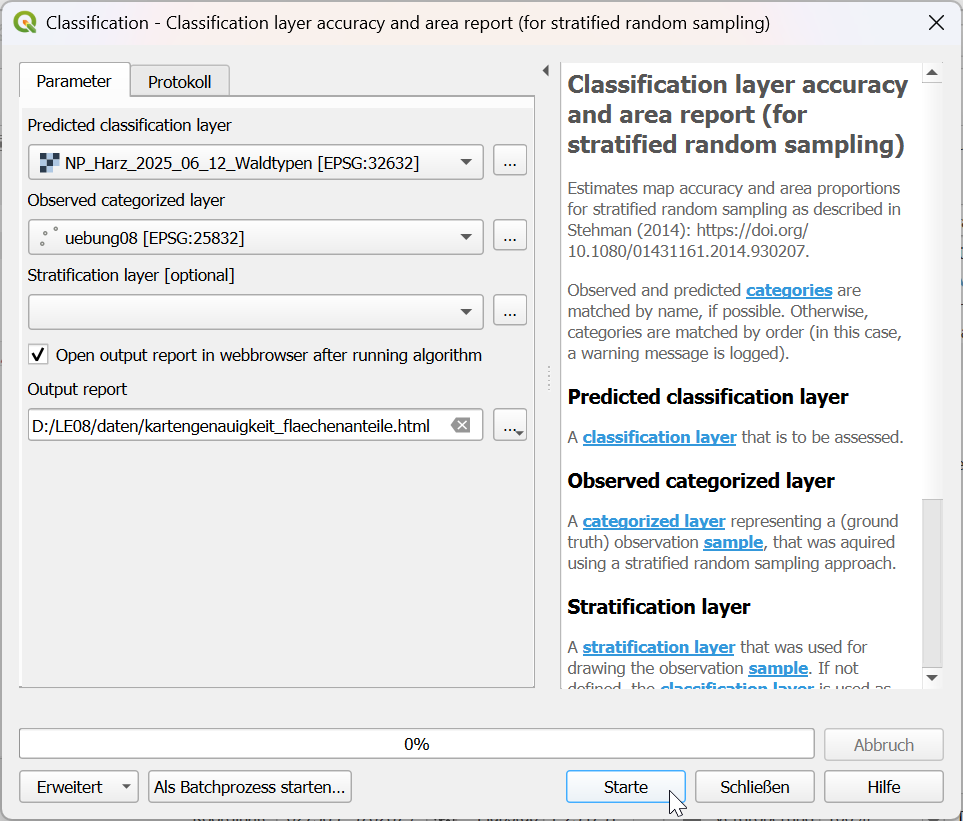
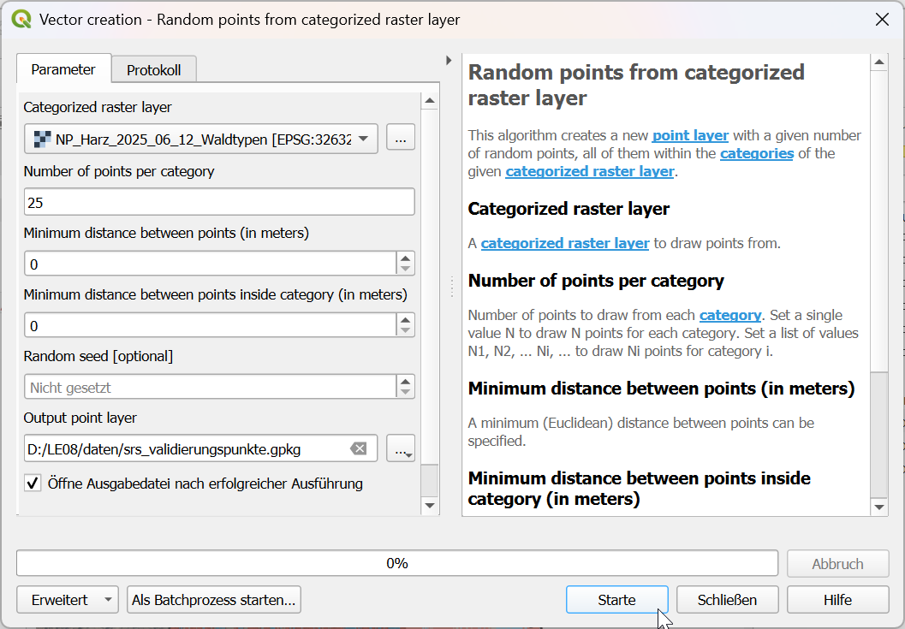

```{=html}
<!--

Skripte für die Übungen 07 des Moduls FPM08 Forstliche Fernerkundung im Studiengang
B.Sc. Forstwirtschaft an der HAWK Göttingen.

Autor: Paul Magdon
Datum: 2025-11-16
Letztes Update: 2026-11-12 (Hans Fuchs)
Lizenz: Creative Commons BY-NC-SA 4.0 https://creativecommons.org/licenses/by-nc-sa/4.0/

-->
```

# Lerneinheit 08: Validierung einer thematischen Waldtypenkarte des Nationalpark Harz



## Lernziele und Aufgabenstellung

In der letzten Übung (@sec-le07) haben wir mithilfe eines automatischen
Bildklassifikationsverfahrens eine einfache Waldtypenkarte für den Nationalpark Harz erstellt. In
der vorliegenden Übung wollen wir nun eine Qualitätsbeurteilung (Validierung) der Landbedeckungskarte mit einem
unabhängigen Referenzdatensatz durchführen, um die thematische Kartengenauigkeit zu ermitteln. Außerdem sollen
Modell- und Kartengenauigkeit miteinander verglichen werden.

**Lernziele**

Die Studierenden sollen:

-   Validierungsdaten für die Qualitätsbeurteilung von thematischen Karten erstellen
-   Mithilfe von Fehlermatrizen die Genauigkeit eine thematischen Karte beurteilen
-   den Unterscheid zwischen Modell- und der Kartengenauigkeit erläutern können.

**Aufgaben**

1.  Raster- und Vektordaten importieren
2.  Erstellen eines Validierungsrasters
3.  Visuelle Interpretation von Ortholuftbildern
4.  Berechnung von Fehlerstatistiken aus der Fehlermatrix
5.  Vergleich der Modell- und Kartengenauigkeit

## Aufgabe 0: Anlegen eine neuen QGIS-Projektes und Kontrolle des Nutzerprofils

Folgen sie der Anleitung aus LE01 @sec-projekt_management, um eine neue Ordnerstruktur und ein neues
QGIS-Projekt für LE07 anzulegen. In der Übung bietet es sich an den Ordner *"daten"* weiter in die
Unterordner *"vektor"* und *"raster"* zu unterteilen.

Prüfen Sie außerdem, ob die Plugins *EnMAP-Box* und *Geobasis_Loader* installiert sind. Sollte dies nicht der Fall sein, stellen Sie Ihr gesichertes
Benutzerprofil wieder her (siehe auch LE01 @sec-nutzerprofil).

## Aufgabe 01: Download und Import der Geodaten

### Hintergrund-Basiskarten
 Laden Sie aus dem Geobasis Loader Katalog 1: Deutschland/Germany:
 
 1. `Deutschland` → `DE: basemap.de Raster HillShade (WMS)` mit dem KBS "ETRS89 / UTM Zone 32N (EPSG:25832)"
 2. `Deutschland` → `DE: basemap.de grau (WFS)` mit KBS "WGS84 / Pseudo Mercator (EPSG:3857)
 
     Markieren Sie den Layer "basemap. de grau" im Layer-Panel.
     `Rechtsklick` → `Eigenschaften` → `Symbolisierung` → `Layereigenschaften`
     
     Stellen sie die Deckkraft mit dem Schieberegler auf ca. 40%.
 
### **Luftbilder**

Für die Erstellung der Validierungsdaten werden Luftbilder mit einer höheren räumlichen Auflösung
genutzt:
Laden Sie aus dem Geobasis Loader Katalog 1: Deutschland/Germany:

1. `Sachsen-Anhalt` → `ST: Digitale Orthophotos - DOP20 (WMS)` mit dem KBS "ETRS89 / UTM Zone 32N (EPSG:25832)"
2. `Niedersachsen`  → `NI: Digitale Orthophotos - DOP20 (WMS)` mit dem KBS "ETRS89 / UTM Zone 32N (EPSG:25832)"

### Vektordaten

Da wir die Validierung auf das Gebiet des Nationalparks beschränken, benötigen wir das
Polygon mit der Außengrenze des Parks, das Sie hier herunterladen können:

<https://cloud.hawk.de/index.php/s/y8RSBSQFG5gaskc>

### Waldtypenkarte

Kopieren Sie sich die zu bewertende Waldtypenkarte mit der passenden qml-Stildatei aus der Übung LE07 in den Ordner "daten/raster" der akuellen Übung (LE08). Sollten Sie keinen Zugriff auf
dieses Bild haben, können Sie sich hier herunterladen:

Waldtypen-Datei *NP_Harz_2025_06_12_Waldtypen.tif*:

<https://cloud.hawk.de/index.php/s/kq9cQoeq787FNTo>

Waldtypen-Stildatei *NP_Harz_2025_06_12_Waldtypen.qml*:

<https://cloud.hawk.de/index.php/s/GkdBzRF9esqQG9P>

Laden Sie die Waldtypen_Datei in Ihr QGIS-Projekt.

## Aufgabe 02: Erstellen eines Validierungslayers mit einer systematischen Stichprobe

Für die Erstellung eines unabhängigen Validierungsdatensatzes ist es wichtig die Punkte, an denen
eine Überprüfung stattfinden soll, nach einem statistischen Verfahren auszuwählen. In der Übung
legen wir ein systematisches Punktraster mit einer Rasterweite von 2000m x 2000m an.
QGIS bietet eine entsprechende Funktion unter `Vektor`→`Forschungswerkzeuge` → `Regelmäßige Punkte...`. 
Hier wählen wir:

-   Eingabeabmessungen: Aus Layer berechnen -\> NP_Harz_2025_06_12_Waldtypen
-   Punktabstände: 2000 Meter
-   Anfänglicher Abstand von Ecke (linke Seite): 5 Meter
-   Benutze Punktabstand: einschalten
-   Layerausgabe-KBS: 25832
-   Regelmäßige Punkte: In Datei speichern -\> Pfad zur Datei "basis_gitter.gpkg"



Die regelmäßigen Punkte werden auf Grundlage der Rasterausdehnung und Pixelgrösse der Waldtypenkarte berechnet.
Mit einem "anfänglicher Einsatz" von 5 Meter werden die Punkte auf den Mittelpunkt der 10 x 10m großen Pixel geschoben.
Punkte außerhalb der Grenzen des Nationalparks können mit der Funktion entfernt werden:

`Vektor-> Geoverarbeitungswerkzeuge-> Zuschneiden` mit folgenden Einstellungen:

-   Eingabelayer: Punktraster "basis_gitter"
-   Überlagerungslayer: Grenze Nationalpark Harz "nlp-harz.gpkg"
-   Zugeschnitten: Wir speichern die Punkte als neues Geopackage "uebung08.gpkg"



Sie sollten in diesem Layer jetzt 61 Punkte innerhalb des Nationalparkgebietes haben.

## Aufgabe 03: Visuelle Interpretation der Validierungspunkte {#sec-visuell_interpret}

Die Überprüfung der Genauigkeit erfolgt auf Grundlage einer visuellen Interpretation. Bevor wir mit
der Interpretation beginnen können, müssen wir noch eine Spalte mit den beobachteten Klassen
anlegen. Dazu öffnen wir die Attributtabelle des Punktlayers. Wir aktivieren den Editiermodus mit dem kleinen Stiftsymbol   und wählen „Neue Spalte hinzufügen" .
 mit folgenden Einstellungen:

-   Name: Code
-   Type: Ganzzahl (Integer 32 bit)

Die Entscheidung zur Klassenzuordnung eines Punktes wird durch Definition einer Referenzfläche vereinfacht. Die Pixelgröße der thematischen Karte hat ein Seitenlänge von 10m. Zur Darstellung einer Interpretationsfläche konstruieren wir einen quadratische Puffer gleicher Flächengröße um jeden Punkt.

- Markieren Sie "uebung08" im Layer-Panel
- `Rechtsklick` → `Eigenschaften` → `Symbolisierung`
- Wählen Sie `Einzelsymbol` → `Markierung` → `Einfache Markierung` aus.
- Symbollayertyp: Wählen Sie "Geometriegenerator" aus der Liste.
- Geometrietyp: "LineString /MultiLineString"
- Folgendes kopieren und in das Ausdrucksfenster einfügen:

```markdown
exterior_ring(bounds(buffer($geometry, 5)))
```



Unter "Einzelsymbol" auf "Linie" klicken:

- Eine **Farbe** (z.B. Pink) auswählen
- Strichbreite: 0,66

Für die Kontrolle der Klassenzuordnung labeln wir die Punkte mit dem Wert der Spalte "Code":

- `Rechtsklick` → `Eigenschaften` → `Symbolisierung` → `Beschriftung`
- "Einzelne Beschriftungen" wählen.
- Wert: Spalte "Code" auswählen.
- Farbe: z.B. Pink auswählen

Für die visuelle Interpretation aktivieren wir den Editiermodus unseres Punktlayers und
interpretieren jeden Punkt auf Grundlage der Luftbilder. Dabei weisen
wir jedem Punkt die Landbedeckungsklasse des Schemas (s. @sec-class_scheme) zu. 
Die Klassenzuordnung erfolgt nach der Landbedeckung mit dem größten Flächenanteil innerhalb der quadratischen Referenzfläche. 

::: callout-note
Für eine effiziente Interpretation ist es sinnvoll, sich die Attributtabelle als Formular anzeigen zu
lassen. Dazu öffnen wir die Attributtabelle und schalten die Ansicht von Tabellenansicht auf
Formularansicht, unten links, um. Anschließend können wir dieses Fenster an unsere QGIS Hauptfenster
andocken. Durch Aktivierung der Funktion „Automatisch zum aktuellen Objekt verschieben“, die sich
unter der Liste mit den einzelnen Punkten befindet, springt der Kartenausschnitt automatisch zum
gewählten Punkt. 



Wir können nundie Punkte einzeln in der Liste von unten nach oben durchgehen und
jeweils die beobachtete Klasse eintragen. Am Ende der visuellen Interpretation sollte für jeden
Punkt eine der vier Klassen in der Attributtabelle eingetragen sein.
:::

## Aufgabe 04: Erstellen einer Fehlermatrix {#sec-error_matrix}

Eine wichtige Voraussetzung zum Erstellen der Fehlermatrix mit der EnMAP-Box: 

Die qml-Stildatei des zu klassifizierten Rasterlayers ("NP_Harz_2025_06_12_Waldtypen.qml") und die qml-Stildatei der beobachteten Validierungspunkte ("uebung08.qml") müssen die gleichen Kategoriewerte und Klassenbezeichnungen haben! 

- Markieren Sie "uebung08" im Layer-Panel
- `Rechtsklick` → `Eigenschaften` → `Symbolisierung`
- Wählen Sie "Kategorisiert" aus.
- Wert: "Code"
- Klicken Sie auf "Klassifizieren"
- Geben Sie in der Spalte "Legende" die gleichen Klassennamen ein wie im Stil von "NP_Harz_2025_06_12_Waldtypen"
- Klicken Sie auf OK.

Einen entsprechend vorbereiteten Stil für die Punkte können auch sie unter folgendem Link herunterladen:

<https://cloud.hawk.de/index.php/s/jYKjnz699xFXRZr>

Zum Laden des Stils öffnen Sie:
`Layereigenschaften` -> `Symbolisierung` -> `Stil` -> `Stil laden` -> `aus Datei`. Dort wählen sie dann die
\*.qml Datei aus.

Öffnen Sie jetzt `Verarbeitung`  →  `Werkzeugkiste`  → `EnMAP-Box` → `Classifcation`  → `Classifcation layer accuracy report`,

In dem dem Funktionsfenster wählen wir die folgenden Einstellungen:

-   **Predicted classifcation layer**: "NP_Harz_2025_06_12_Waldtypen" 

-   **Observed categorized layer**: "uebung08"

-   **Output report**:   Hier geben wir an, wo der Bericht über die Kartengenauigkeit gespeichert werden soll. Wir wählen *„kartengenauigkeit.html“* im Ordner *"daten"*.



Anschließend starten wir die Berechnung. Als Ergebnis öffnet sich ein Report im Webbrowser.

::: {style="border: 3px solid #ff8a0b; background-color: #ffffff; padding: 8px;"}
1.  *Wie beurteilen Sie die Genauigkeit der Klassifikation?*
2.  *Welche Nutzergenauigkeit hat die Klasse „stehendes Totholz“?*
:::

## Aufgabe 05: Vergleich Modell- und Kartengenauigkeit

Bei der Erstellung des *RandomForest* Klassifikationsmodells (siehe @sec-rf_training) haben wir auch
einen Bericht über die Modellgenauigkeit gespeichert. Dieser wurde auf Basis der Trainingsdaten
berechnet, da wir zum Zeitpunkt des Modelltrainings die Validierungsdaten noch nicht erstellt
hatten. Insofern beschreibt diese Fehlermatrix die Modellgenauigkeit.

Vergleichen Sie die Fehlermatrizen der Modell- und Kartengenauigkeit, um untenstehende Fragen zu beantworten.

::: {style="border: 3px solid #ff8a0b; background-color: #ffffff; padding: 8px;"}
1.  *Welche Fehlermatrix liefert eine höhere Gesamtgenauigkeit?*
2.  *Wie begründen sie die Unterschiede zwischen den beiden Fehlermatrizen?*
3.  *Welche Fehlermatrix würden sie für die Bewertung der praktischen Nutzbarkeit der Karte
    verwenden?*
:::

## Aufgabe 06: Kartengenauigkeit und Flächenanteile (Optional) {#sec-accuracy_area}

Eine systematische Stichprobe eignet sich auch zur Schätzung von Flächenanteilen nach Stehman (2014).

Stehman, S. V., 2014. Estimating area and map accuracy for stratified random sampling when the strata are different from the map classes. Int. J. Remote Sens. 35, 4923-4939 <https://doi.org/10.1080/01431161.2014.930207>.

Öffnen Sie  `Verarbeitung`  →  `Werkzeugkiste`  → `EnMAP-Box` → `Classifcation`  → `Classifcation layer accuracy rand area report (for stratified random sampling)`

In dem dem Funktionsfenster wählen wir die folgenden Einstellungen:

-   **Predicted classifcation layer**: "NP_Harz_2025_06_12_Waldtypen" 

-   **Observed categorized layer**: "uebung08"

-   **Output report**:   Hier geben wir an, wo der Bericht über die Kartengenauigkeit gespeichert werden soll. Wir wählen *„kartengenauigkeit_flaeche.html“* im Ordner *"daten"*.



## Aufgabe 07: Erstellen eines Validierungslayers mit einer stratifizierten Zufallsstichprobe (Optional)

Die Verwendung eines systematischen Stichprobendesigns hat viele Vorteile; es kann z.B. auch für die Schätzung von Flächenanteilen verwendet werden (s. @sec-accuracy_area). Wenn nur die Schätzung der Kartengenauigkeit im Vordergrund steht und Flächenanteile der Klassen in der thematischen Ergebniskarte unausgeglichen bzw. einige Klassen sehr geringe Flächenanteile haben, ist die Verwendung einer stratifizierten Zufallsauswahl mit gleichem Stichprobenumfang pro Klasse viel effektiver.
Der Arbeitsaufwand bei der visuellen Interpretation der Validierungspunkte ist dann geringer als bei einer systematischen Auswahl 
(vergl. Stehman and Foody (2019)).

S.V. Stehman and G.M. Foody, 2019: Key issues in rigorous accuracy assessment of land cover products,
Remote Sensing of Environment, <https://www.sciencedirect.com/science/article/pii/S0034425719302111>)

Öffnen Sie  `Verarbeitung`  →  `Werkzeugkiste`  → `EnMAP-Box` → `Vector creation` → `Random points from categorized raster layer`

-   **Categorized raster layer**: "NP_Harz_2025_06_12_Waldtypen" 

-   **Number of points per category**: 25

-   **Output point layer**: Hier geben wir an, wo die Validierungspunkte gespeichert werden soll. Wir wählen *„srs_validierungspunkte.gpkg“* im Ordner *"daten/vektor"*.



Sie können den Punkten nun Klassen zuweisen mithilfe einer visuellen Interpretation (s. Aufgabe 03 @sec-visuell_interpret) und eine Fehlermatrix berechnen (s. Aufgabe 04 @sec-error_matrix). Vergleichen Sie die Kartengenauigkeit der systematischen Stichprobe mit der stratifizierten Zufallsstichprobe.  

