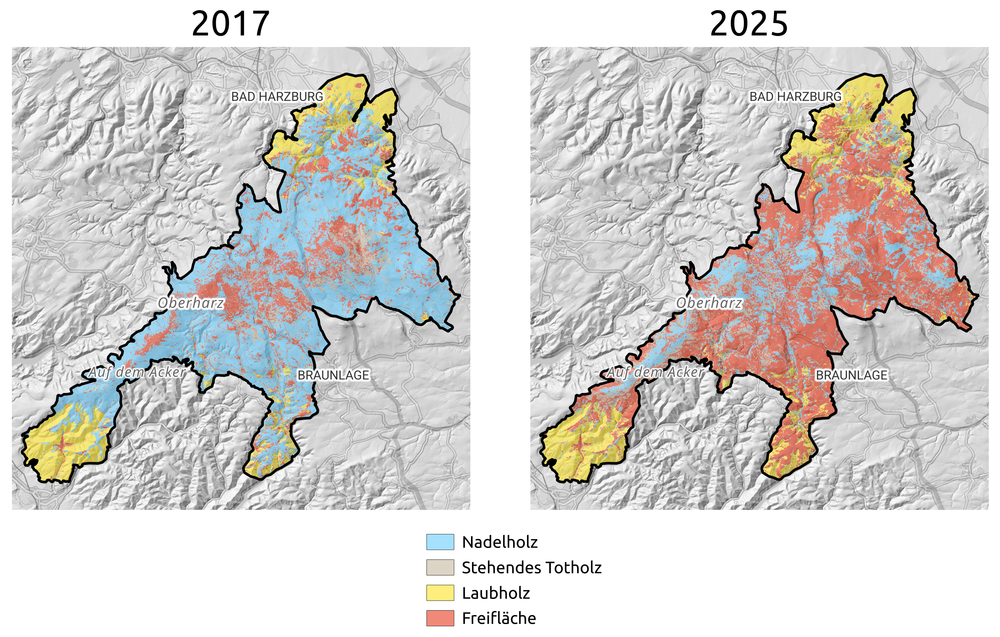
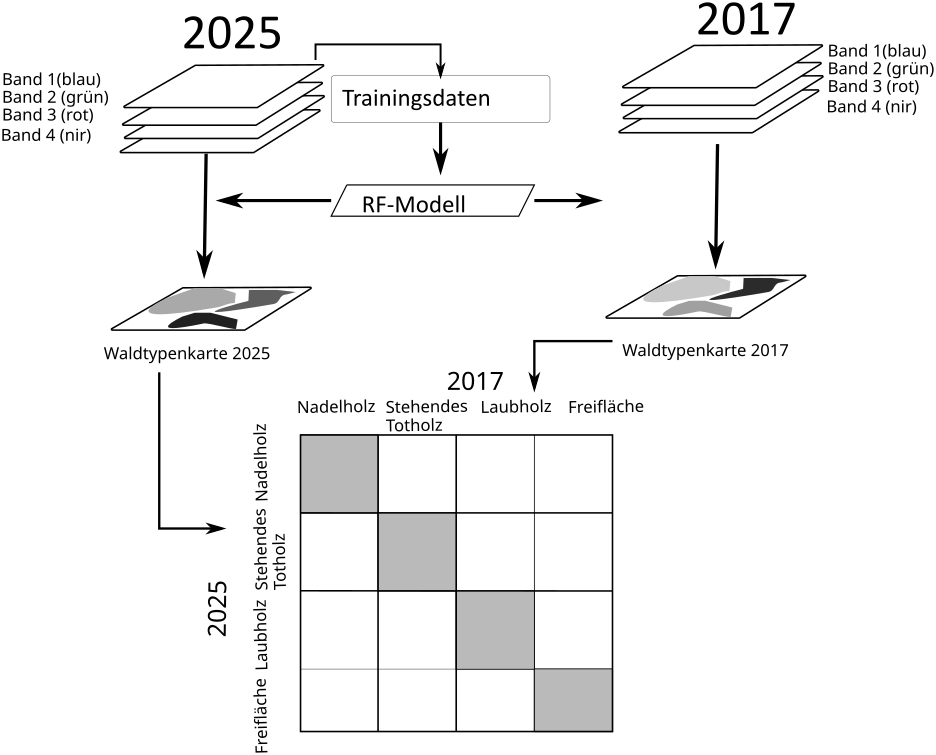
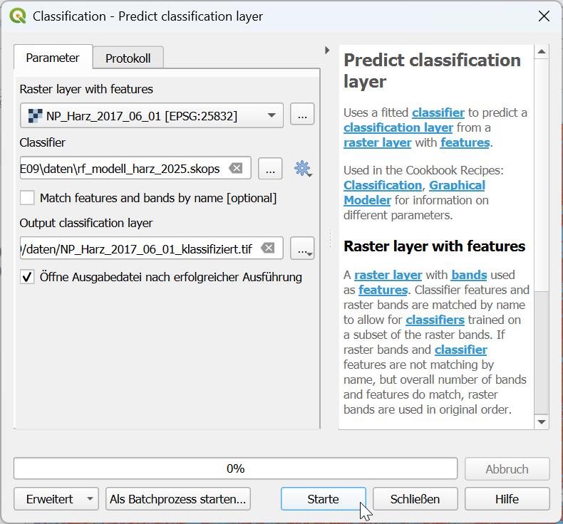
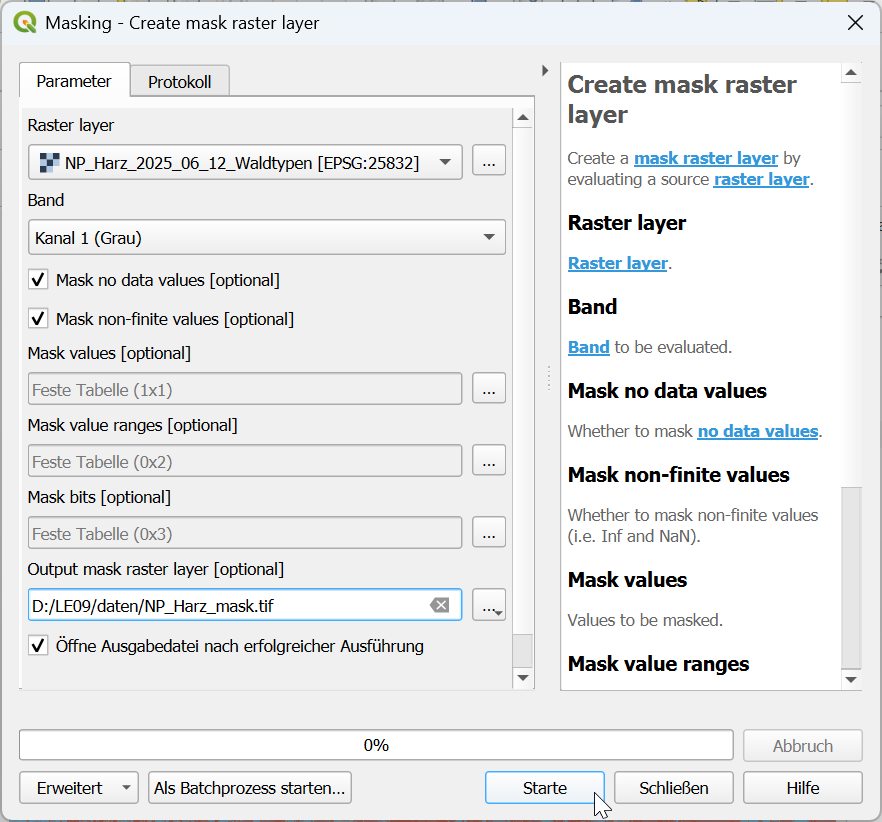
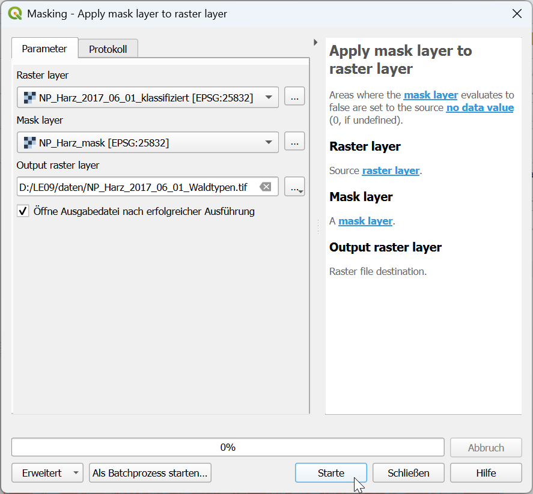
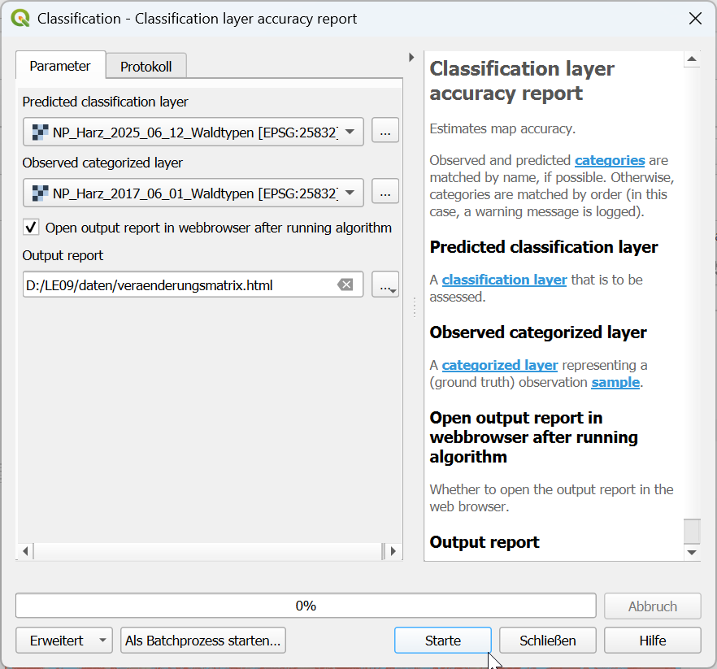
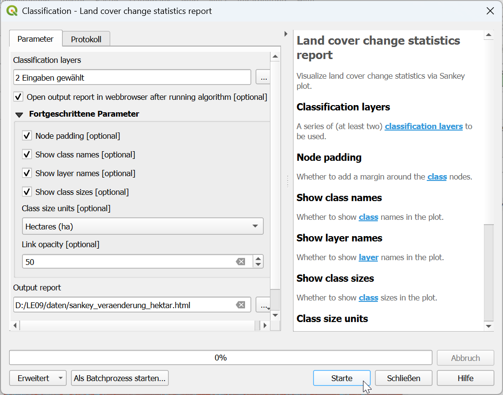

```{=html}
<!--

Skripte für die Übungen 09 des Moduls FPM08 Forstliche Fernerkundung im Studiengang
B.Sc. Forstwirtschaft an der HAWK Göttingen.

Autor: Paul Magdon
Datum: 2025-11-29
Letztes Update: 2026-11-14 (Hans Fuchs)
Lizenz: Creative Commons BY-NC-SA 4.0 https://creativecommons.org/licenses/by-nc-sa/4.0/

-->
```

# Lerneinheit 09: Analyse der Waldflächenänderung im Nationalpark Harz (2017 - 2025)



## Lernziele und Aufgabenstellung

In der der Übung (@sec-le07) haben wir mithilfe eines automatischen Bildklassifikationsverfahrens
eine einfache Waldtypenkarten für den Nationalpark Harz erstellt. Dafür wurden Trainingsdaten
erhoben und ein RandomForest Klassifikationsmodell erstellt. In der vorliegenden Übung wird dieses
Modell verwendet, um ein älteres Satellitenbild zu klassifizieren und eine Waldtypenkarte für das
Jahr 2017 zu erstellen. Anschließend sollen die Waldtypenkarten 2017 und 2015 miteinander verglichen und die
Änderung der Waldflächen quantifiziert werden.

{fig-align="center"}

**Lernziele**

Die Studierenden sollen:

-   Ein bestehendes Klassifikationsmodell auf einen weiteres Satellitenbild anwenden.
-   Zwei Waldtypenkarten mithilfe einer Änderungsmatrix vergleichen.
-   Die Waldflächenänderung bestimmen.

**Aufgaben**

1.  Raster- und Vektordaten importieren
2.  Erstellen einer Waldtypenkarte für das Jahr 2017
3.  Erstellen einer Änderungsmatrix 
4.  Auswertung der Änderungsmatrix zur Bestimmung der Waldflächenänderungen 2017-2025

## Aufgabe 0: Anlegen eine neuen QGIS-Projektes und Kontrolle des Nutzerprofils

Folgen sie der Anleitung aus LE01 @sec-projekt_management um eine neue Ordnerstruktur und ein neues
QGIS-Projekt für LE09 anzulegen. In der Übung bietet es sich an den Ordner *"daten"* weiter in die
Unterordner *"vektor"* und *"raster"* zu unterteilen.

Prüfen Sie außerdem, ob die Plugins *EnMAP-Box* und *Geobasis_Loader* installiert sind. Sollte dies nicht der Fall sein, stellen Sie Ihr gesichertes
Benutzerprofil wieder her (siehe auch LE01 @sec-nutzerprofil).

## Aufgabe 01: Download und Import der Geodaten

### **Satellitenbilder und Waldtypenkarten**

Laden Sie sich das Satellitenbild *"NP_Harz_2025_06_12.tif"* und die Waldtypenkarte *"NP_Harz_2025_06_12_Waldtypen.tif"* für das Jahr 2025  aus der Übung @sec-le07 in Ihren aktuelleb Projektordner LE09. Falls sie keinen Zugang mehr zu diesen Daten haben
können Sie sich unter folgendem herunterladen:

Satellitenbild 2025:

<https://cloud.hawk.de/index.php/s/i56LB4dCBxt4cm6>

Waldtypenkarte 2025:

<https://cloud.hawk.de/index.php/s/5FRfCaH3gTGexC6>

Der Waldzustand im Jahr 2025 soll mit der Situation im Jahr 2017 vor den großen Kalamitäten 
verglichen werden. Für die Erstellung einer Waldtypenkarte 2017 soll das gleiche RandomForest
Klassifikationsmodell verwendet werden, das für 2025 erstellt wurde. Daher ist es wichtig, dass die Satellitenbilder der beiden
Jahre miteinander vergleichbar sind. Wir nutzen dazu ein Satellitenbild des selben Sensors (S2-MSI) und Datentyps (L2A),
das zu einem ähnlichen phänologischen Zeitpunkt (Juni) aufgenommen wurde. Sie können das
vorbereitete Sentinel-2 Satellitenbild 2017 hier herunterladen:

Satellitenbild 2017:

<https://cloud.hawk.de/index.php/s/onBgcri8igW6czi>

Für die farbige Darstellung der thematischen Karten können Sie diese Stildatei zusätzlich
herunterladen:

<https://cloud.hawk.de/index.php/s/nbn3YQsAoGM7jEd>

### **Vektordaten**

Laden Sie sich außerdem die Außengrenze des Nationalparks herunter:

<https://cloud.hawk.de/index.php/s/MmT7fwzZ3Z2sNex>

### Modelle

Für die Klassifikation nutzen wir das RandomForest (RF) Klassifikationsmodell, das in der Übung
@sec-le07 auf Basis der Trainingsdaten angelegt wurde, noch einmal. Bitte hier herunterladen:

<https://cloud.hawk.de/index.php/s/RamYqcKbYSRsZda>

## Aufgabe 02: Erstellen der Waldtypenkarte 2017

- Laden sie das Satellitenbild 2017  in das QGIS Projekt.
- Nutzen sie anschließend die Enmap-Box Funktion *"Predict classifcation layer"*, um mithilfe des RF-Modells eine neue Waldtypenkarte für das Jahr 2017 zu erstellen. 
- Speichern sie die neue Waldtypenkarte als Raster unter dem Dateinamen *NP_Harz_2017_06_01_Waldtypen_klassifiziert.tif* ab. Nutzen sie dazu auch die Hinweise aus @sec-rf_inference.



Für einen Änderungsanalyse sollten Rasterdaten dieselbe Ausdehnung, Lage und Grösse der Pixel und dasselbe Koordinatenbezugssystem haben.

Mit der Funktion `Create mask raster layer`aus der EnMAP-Box können Sie eine Binärmaske erstellen:

- **Raster layer**: NP_Harz_2025_06_12_Waldtypen

- **Band**: Kanal 1

- **Mask values**: Geben Sie hier als zusätzlichen  Leerwert **0** ein!

- **Output mask raster layer**: NP_Harz_mask.tif



Die Binärmaske kann jetzt mit der EnMAP-Box Funktion `Apply mask layer to raster layer` auf die neue Waldtypenkarte 2017 angewendet werden:

- **Raster layer**: NP_Harz_2017_06_01_klassifiziert.tif
- **Mask layer**: NP_Harz_mask.tif
- **Output mask raster layer**: NP_Harz_2017_06_01_Waldtypen.tif



Zum visuellen Vergleich der Waltypenentwicklung können Sie die Stildatei `NP_Harz_2025_06_12_Waldtypen.qml` in **beide** Rasterlayer *NP_Harz_2017_06_01_Waldtypen* und *NP_Harz_2025_06_12_Waldtypen* laden.


::: {style="border: 3px solid #ff8a0b; background-color: #ffffff; padding: 8px;"}
1.  *Wie beurteilen Sie die Genauigkeit der Klassifikation für das Jahr 2017?*
2.  *Welche Probleme sehen Sie bei der Übertragung des Klassifikationsmodells aus dem Jahr 2025 auf
    das Jahr 2017?*
:::

## Aufgabe 03: Erstellen einer Änderungsmatrix

Vergleichbar zur Fehlermatrix, werden in einer Änderungsmatrix die Klassifikationsergebnisse der
beiden Jahre in einer Kreuztabelle gegenüber gestellt. Da beide Klassifikationen auf
S2-Satellitenbildern beruhen, kann der Vergleich direkt auf Ebene einzelner Pixel
durchgeführt werden. Es muss also kein systematisches Punktraster erstellt werden. Für den
Vergleich auf Pixelebene kann die EnMAP-Funktion `Classification layer accuracy report` genutzt werden.

Hier bei werden folgende Einstellungen gewählt:

- **Predicted classifcation layer**: Waldtypen zum *Zeitpunkt **2** * *NP_Harz_2025_06_12_Waldtypen.tif* und

- **Observed categorized layer**: Waldtypen zum *Zeitpunkt **1** * *NP_Harz_2017_06_01_Waldtypen.tif* 

- **Output report**: veraenderungsmatrix.html



Als Ergebnis wird ein Bericht im Webbrowser angezeigt, wobei die 2. Kreuztabelle jetzt als Veränderungsmatrix zu interpretieren ist.

In der Veränderungsmatrix sind die Pixelwerte aus dem Jahr 2017 in den Spalten und die Werte aus dem Jahr 2025 in den Zeilen aufgetragen. In der Diagonale befinden sich die Pixel, die zu beiden Zeitpunkten der gleichen Klasse zugeordnet wurden.

## Aufgabe 04: Berechnung der Flächenänderungen

Erstellen Sie  eine Veränderungsmatrix mit der Einheit Hektar. Öffnen Sie hierfür die Textdatei **"daten/veraenderungsmatrix.html.csv"** in einem Tabellenkalkulationsprogramm.  

Jetzt können Sie zwei Versionen der Änderungsmatrix vergleichen:

i)  mit der Anzahl der Pixel
ii) mit den ha-Werten.

Nutzen sie die beiden Matrizen zum Beantworten folgender Fragen:

::: {style="border: 3px solid #ff8a0b; background-color: #ffffff; padding: 8px;"}
1.  *Wie groß ist der Anteil an Verlust von Nadelholzflächen im NP-Harz zwischen 2017-2025?*
2.  *Wie viel ha Freiflächen gibt es im NP-Harz im Jahr 2025?*
3.  *Wie hat sich der Anteil der stehenden Totholzflächen von 2017-2025 geändert?*
:::

## Aufgabe 05: Erstellung eines Sankey Veränderungsdiagramms

Ein Sankey Veränderungsdiagramm wird durch Aufrufen der EnMAP-Box Funktion `Land cover change statistics report` hergestellt:

- **Classification layers**: Wählen Sie `NP_Harz_2017_06_01_Waldtypen` und `NP_Harz_2025_06_12_Waldtypen` aus.

- **Class size units**: Hectares (ha)

- **Link opacity**: 50

- **Output report**: sankey_veraenderung_hektar.html



Vergleichen Sie die Werte im Sankey Diagramm mit den Werten in den Änderungsmatrizen i) mit der Anzahl der Pixel und ii) mit der Fläche in ha.

